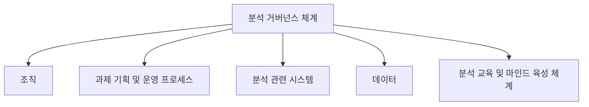
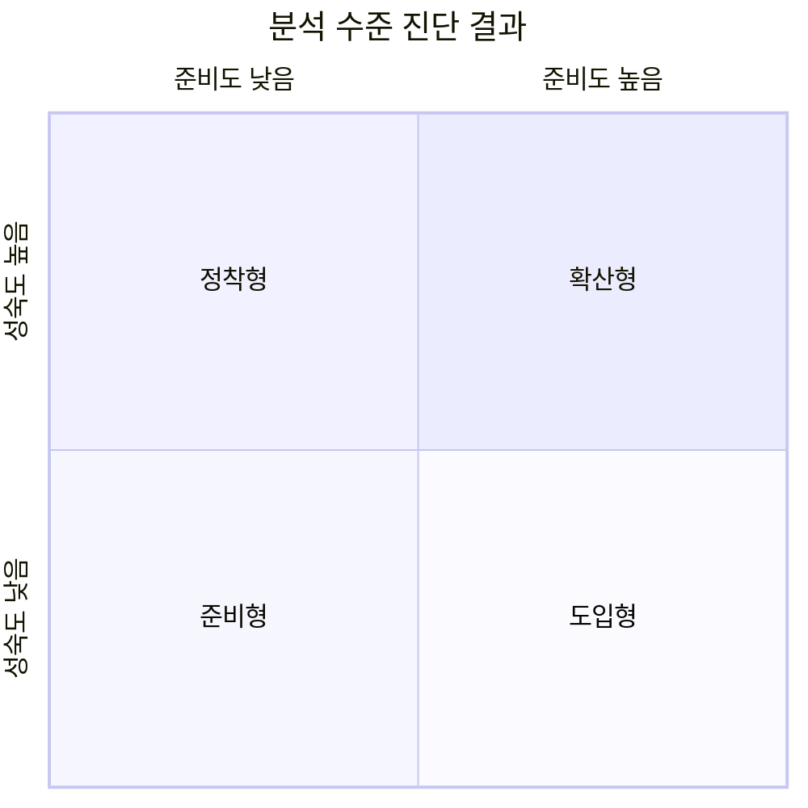

# 분석 거버넌스 체계와 분석 수준 진단

> 2과목 데이터 분석 기획 › 2장 분석 마스터 플랜

---

# 분석 거버넌스 체계

## 분석 거버넌스의 개념

| 개념 | 정의 |
|---|---|
| **거버넌스 (Governance)** | **통치**를 뜻하는 용어 |
| **분석 거버넌스** | 기업에서 의사결정을 위한 **데이터의 분석과 활용을 위한 체계적인 관리** |

| 항목 | 설명 |
|---|---|
| **목적** | 단순히 대용량 데이터를 수집·축적하는 것이 아니라, **어떤 목적으로 어떤 분석을 수행할지**, 분석을 위해 **어떻게 데이터를 활용할지** 결정 |
| **지향점** | 데이터 분석을 **기업의 문화로 정착**시키고, 데이터 분석 업무를 **고도화**하기 위해 데이터 관리 체계를 수립하는 것 |

### 분석 거버넌스 체계 구성요소 ⭐

| 구성요소 | 내용 |
|---|---|
| **조직 (Organization)** | 분석 기획 및 관리를 수행 |
| **과제 기획 및 운영 프로세스 (Process)** | 분석 과제의 발굴·기획·운영 절차 |
| **분석 관련 시스템 (System)** | 분석을 지원하는 IT 인프라 및 플랫폼 |
| **데이터 (Data)** | 분석에 활용되는 데이터와 그 관리 체계 |
| **분석 교육 및 마인드 육성 체계 (Human Resource)** | 분석 관련 교육과 조직 구성원의 분석 마인드 육성 |

> **암기 요령**: **조직 · 프로세스 · 시스템 · 데이터 · 교육** 5가지

---

## 분석 수준 진단 프레임워크

| 항목 | 설명 |
|---|---|
| **배경** | 데이터를 **어떻게 활용하느냐가 기업의 경쟁력을 좌우**함 |
| **필요성** | 기업은 데이터 분석의 **도입 여부와 활용 여부**에 대한 분석 수준을 점검하고 고도화할 필요가 있음 |
| **진단 방법** | **분석 준비도**와 **분석 성숙도**를 통해 데이터 분석 수준을 진단 |
| **활용** | 데이터 분석 기반을 구현하기 위해 어떤 준비를 해야 하는지 등 **분석의 유형 및 분석의 방향성**을 결정할 수 있음 |

---

### 1️⃣ 분석 준비도 (Readiness)

| 항목 | 내용 |
|---|---|
| **정의** | 기업의 **데이터 분석 역량을 파악**하는 방법 |
| **진단 영역** | **6가지 영역**을 대상으로 수준을 파악 |

| 진단 영역 | 진단 내용 |
|---|---|
| **분석 업무** | 어떤 분석 업무를 수행하고 있는가 |
| **분석 기법** | 업무에 적합한 분석 기법을 사용하는가 |
| **분석 데이터** | 분석에 필요한 데이터를 확보·관리하는가 |
| **분석 인력 및 조직** | 분석 전문 인력과 전담 조직이 있는가 |
| **분석 문화** | 데이터 기반 의사결정 문화가 정착되었는가 |
| **분석 인프라** | 분석을 지원할 IT 시스템과 기술이 갖춰졌는가 |

> **암기 요령**: **업무 · 기법 · 데이터 · 인력조직 · 문화 · 인프라** 6가지

**영역별 세부 진단 항목** ⭐

| 영역 | 세부 항목 |
|---|---|
| 분석 업무 파악 | 발생한 사실 분석, 예측 분석, 시뮬레이션 분석, 최적화 분석 업무, 분석 업무 정기적 개선 |
| 인력 및 조직 | 분석 전문가 직무 존재, 분석 전문가 교육 훈련, 관리자들의 기본 분석 능력, 전사 분석 업무 총괄 조직, 경영진의 분석 업무 이해 |
| 분석 기법 | 업무별 적합한 분석 기법 사용, 분석 업무 도입 방법론, 분석 기법 라이브러리, 분석 기법 효과성 평가, 정기적 개선 |
| 분석 데이터 | 데이터의 충분성·신뢰성·적시성, 비구조적 데이터 관리, 외부 데이터 활용 체계, 기준 데이터 관리 |
| 분석 문화 | 사실에 근거한 의사결정, 관리자의 데이터 중시, 회의 등에서 데이터 활용, 경영진의 직관보다 데이터, 데이터 공유 및 협업 문화 |
| IT 인프라 | 운영 시스템 데이터 통합, EAI·ETL 등 데이터 유통 체계, 분석 전용 서버 및 스토리지, 빅데이터·통계·비주얼 분석 환경 |

> 준비도 항목별 수준이 **일정 이상이면 분석 업무를 도입**하고, 미흡하면 **분석 환경부터 조성**한다.

---

### 2️⃣ 분석 성숙도 (Maturity)

| 항목 | 내용 |
|---|---|
| **참조 모델** | 소프트웨어 분야의 성숙도 평가 모델인 **CMMI**를 활용 |
| **진단 부문** | **비즈니스 부문 / 조직·역량 부문 / IT 부문**의 **3개 부문** |
| **성숙도 단계** | **도입 → 활용 → 확산 → 최적화**의 4단계 |

#### 분석 성숙도 평가표 ⭐

| 단계 | 설명 | 비즈니스 부문 | 조직 · 역량 부문 | IT 부문 |
|---|---|---|---|---|
| **1단계 도입** | 분석을 **시작**하여 환경과 시스템을 구축 | 실적 분석 및 통계 정기 보고 수행 운영 데이터 기반 | 일부 부서에서 수행 담당자 역량에 의존 | 데이터 웨어하우스 데이터 마트 ETL / EAI OLAP |
| **2단계 활용** | 분석 결과를 **실제 업무에 적용** | 미래 결과 예측 시뮬레이션 운영 데이터 기반 | 전문 담당 부서에서 수행 분석 기법 도입 관리자가 분석 수행 | 실시간 대시보드 통계 분석 환경 |
| **3단계 확산** | **전사 차원**에서 분석을 관리·공유 | 전사 성과 실시간 분석 프로세스 혁신 3.0 분석 규칙 관리 이벤트 관리 | 전사 모든 부서 수행 분석 COE 조직 운영 데이터 사이언티스트 확보 | 빅데이터 관리 환경 시뮬레이션·최적화 비주얼 분석 분석 전용 서버 |
| **4단계 최적화** | 분석을 **진화**시켜 혁신 및 성과 향상 | 외부 환경 분석 활용 최적화 업무 적용 실시간 분석 비즈니스 모델 진화 | 데이터 사이언스 그룹 경영진 의사결정 활용 전략 도구로 활용 | 분석 협업 환경 분석 SandBox 프로세스 내재화 빅데이터 분석 |

> **흐름 이해**: 도입(보고서 수준) → 활용(예측 시작) → 확산(전사 공유) → 최적화(전략 도구화)

---

### 3️⃣ 분석 수준 진단 결과 ⭐

| 항목 | 내용 |
|---|---|
| **활용 방법** | 기업의 분석 준비도와 성숙도 결과를 토대로 **유관 업종 또는 경쟁사의 분석 수준과 비교**하여 분석 기술 강화를 위한 **목표 수준을 설정** |
| **구분** | **4가지 유형**으로 분석 결과를 구분해 향후 개선 방향 등을 선정 |

| 유형 | 준비도 | 성숙도 | 의미 |
|---|---|---|---|
| **준비형** | 낮음 | 낮음 | 데이터·인력·조직·분석 업무 등이 **전반적으로 미흡** → 사전 준비부터 필요 |
| **정착형** | 낮음 | 높음 | 준비도는 낮지만 **일부 부서에서 분석이 이미 이뤄지고 있음** → 분석의 **일차적 정착** 상태 |
| **도입형** | 높음 | 낮음 | 조직·인력 등 **기반은 갖췄으나 분석 역량이 부족** → 바로 **분석을 도입**하면 됨 |
| **확산형** | 높음 | 높음 | 6개 준비도 영역을 **모두 갖추고 지속 확산 중** → 가장 성숙한 단계 |

> **헷갈림 방지**: **도입형**은 "도입할 **준비**가 됐다" → 준비도 높음. **정착형**은 "이미 일부는 하고 있다" → 성숙도 높음. 이 둘을 뒤바꾸는 것이 단골 함정이다.

---

## 분석 지원 인프라 방안 수립

### 플랫폼으로 인프라 구축

| 항목 | 내용 |
|---|---|
| **개별 구축의 문제** | 분석 과제 단위별로 별도의 분석 시스템을 구축하는 경우, **관리의 복잡도 및 비용 증가**라는 부작용 발생 |
| **권장 방향** | 분석 마스터플랜을 **기획하는 단계부터** 장기적·안정적으로 활용할 수 있는 **확장성을 고려한 플랫폼 구조**를 도입하는 것이 적절 |

### 개별 시스템 vs 플랫폼 구조 ⭐

| 구분 | 개별 시스템 | 플랫폼 구조 |
|---|---|---|
| **데이터 교환** | 시스템 간 **자체적인** 데이터 교환 | 분석 플랫폼을 활용한 **공통 기능 활용** |
| **데이터 관리** | 시스템별 **독립적인** 데이터 관리 | **중앙 집중적** 데이터 관리 |
| **확장 시** | 시스템 간 **인터페이스 폭증** | 시스템 간 **인터페이스 최소화** |

> **핵심**: 분석 과제가 늘어날수록 개별 시스템은 감당이 안 된다. **플랫폼 구조가 권장 방향**이다.
