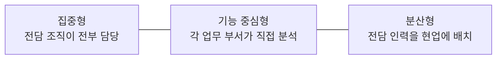
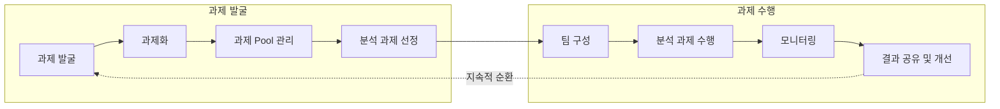
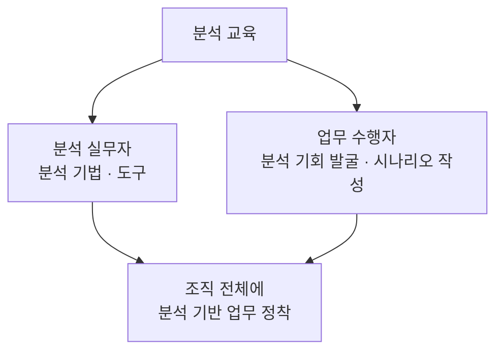

# 분석 조직 · 과제 관리 · 교육과 변화관리

> 2과목 데이터 분석 기획 › 2장 분석 마스터 플랜

---

# 데이터 조직 및 인력방안 수립

## 데이터 분석 조직

| 항목 | 내용 |
|---|---|
| **역할** | 기업 내에 존재하는 **빅데이터 속에서 가치를 찾아 전파하고 이를 행동화**하는 역할 수행 |
| **구성** | 분석 방법에 대한 **지식과 분석 경험을 가진 인력**으로 구성 |
| **목표** | 기업의 경쟁력 확보를 위해 **비즈니스 질문에 부합하는 가치를 찾고 비즈니스를 최적화**하는 것 |

---

## 조직 및 인력 구성 시 고려사항 ⭐

### 조직 구조 관점

| 고려사항 |
|---|
| 비즈니스 질문을 **선제적으로 찾아낼 수 있는 구조**인가 |
| 분석 전담 조직과 **타 부서 간 유기적인 협조와 지원**이 원활한 구조인가 |
| 효율적인 분석 업무 수행을 위한 **분석 조직의 내부 조직 구조**는 어떠한가 |
| 전사 및 단위 부서가 필요할 경우 **접촉하며 지원할 수 있는 구조**인가 |
| **어떤 형태의 조직**으로 구성하는 것이 효율적인가 |

### 인력 구성 관점

| 고려사항 |
|---|
| **비즈니스 및 IT 전문가의 조합**으로 구성되어야 하는가 |
| **어떤 경험과 스킬**을 갖춘 사람으로 구성해야 하는가 |
| **통계적 기법 및 분석 모델링 전문 인력**을 별도로 구성해야 하는가 |
| 전사 비즈니스를 커버하는 인력이 없다면 어떻게 할 것인가 |
| 전사 분석 업무에 대한 **적합한 인력 규모**는 어느 정도인가 |

> **핵심**: 조직 구조는 "**어떻게 배치할 것인가**", 인력 구성은 "**누구를 얼마나 둘 것인가**"의 문제다.

---

---

## 데이터 분석 조직 유형 ⭐

분석 조직은 **어디에 두고 누가 분석하느냐**에 따라 세 가지 유형으로 나뉜다.

### 1️⃣ 집중형 조직 구조

| 항목 | 내용 |
|---|---|
| **형태** | 조직 내에 **별도의 독립적인 분석 전담 조직**을 구성하고, 회사의 **모든 분석 업무를 전담 조직에서 담당** |
| **과제 추진** | 분석 담당 조직 내부에서 기업 분석 과제의 **전략적인 중요도에 따라 우선순위를 정해** 추진 |
| **단점** | 일부 현업 부서와 분석 업무가 **중복 또는 이원화될 가능성**이 있음 |

### 2️⃣ 기능 중심의 조직 구조

| 항목 | 내용 |
|---|---|
| **형태** | 일반적으로 분석을 수행하는 형태로, **별도의 분석 조직을 구성하지 않고 각 해당 업무 부서에서 직접 분석** |
| **단점** | 제대로 된 분석이 힘들 수 있음 **특정 영역에 국한된 분석**을 수행할 가능성이 높음 분석 업무의 **이원화 또는 일부 중복** 발생 가능 |

### 3️⃣ 분산형 조직 구조

| 항목 | 내용 |
|---|---|
| **형태** | **분석 조직의 인력을 현업 부서에 배치**해 분석 업무를 수행 |
| **장점** | 기업에서 **분석 과제의 우선순위를 선정해 수행** 가능 분석 결과를 **신속하게 실무에 적용**할 수 있음 |

### 세 유형 비교

| 구분 | 집중형 | 기능 중심형 | 분산형 |
|---|---|---|---|
| **전담 조직** | 있음 (독립) | 없음 | 있음 (현업에 배치) |
| **분석 수행 주체** | 전담 조직 | 각 업무 부서 | 현업에 배치된 분석 인력 |
| **핵심 특징** | 전사 우선순위 관리 | 부서별 자체 분석 | 현업 밀착 + 신속 적용 |
| **주요 이슈** | 현업과 **중복·이원화** | **국한된 분석**, 중복 발생 | — (장점 중심 서술) |

> **구분 요령**: **집중형**은 "한곳에 모아서", **기능 중심형**은 "각자 알아서", **분산형**은 "보내서 같이". 집중형과 분산형 모두 전담 인력이 있지만 **어디에 앉아 있느냐**가 다르다.

**보충** ⭐

| 항목 | 내용 |
|---|---|
| 분석 전담 조직 | 교재에선 **DSCoE**(데이터 사이언스 전문 조직)로 표기 |
| 분산형 이슈 | 전사 차원 우선순위 수행 + 신속한 실무 적용 + 모범 사례 공유가 가능하지만, **부서 분석 업무와 역할 분담을 명확히** 해야 함 |
| 기능 중심형 이슈 | **전사적 관점의 핵심 분석이 어렵고**, 과거 실적 분석에 국한될 가능성 |

### 분석 조직 인력 구성

| 인력 | 역할 |
|---|---|
| 비즈니스 인력 | 업무 이해, 분석 과제 정의 |
| IT 기술 인력 | 데이터 추출·가공, 시스템 구축 |
| 분석 전문 인력 | 통계·머신러닝 모델링 |
| 변화관리 인력 | 분석 문화 확산 |
| 교육 담당 인력 | 분석 교육 |

---
---

# 분석 과제 관리 프로세스 수립

## 개요

| 항목 | 내용 |
|---|---|
| **배경** | 분석 마스터플랜이 수립되고 분석 과제가 성공적으로 수행되었다면, 지속적인 **분석 니즈 및 기회가 분석 과제 형태로 도출**될 수 있음 |
| **필요성** | 도출된 분석 과제들을 **체계적으로 관리하기 위한 프로세스**가 요구됨 |
| **기대 효과** | 체계적인 분석 과제 관리 프로세스를 수행함으로써 **기업 내 분석 문화를 내재화**할 수 있음 |

---

## 분석 과제 관리 프로세스

크게 **과제 발굴**과 **과제 수행** 두 단계로 나뉜다.

| 단계 | 수행 내용 |
|---|---|
| **과제 발굴** | 개별 조직 혹은 개인이 **과제를 발굴**하고 이를 **과제화**하여 **Pool로 관리**한 뒤 **분석 과제를 선정** |
| **과제 수행** | 선정된 과제에 대하여 **팀을 구성**하고 분석 과제를 수행하면서 **지속적인 모니터링**을 병행하고, 그 **결과를 공유 및 개선**하는 절차를 수행 |

> **Pool**: 사용 가능한 데이터·과제의 집합. 발굴된 과제를 바로 실행하지 않고 **모아두었다가 선정**하는 것이 핵심이다.

---
---

# 분석 교육 및 변화관리

## 개요

| 항목 | 내용 |
|---|---|
| **배경** | 빅데이터 등장에 따른 변화로, 기업은 **적합한 분석 업무를 도출**하고 가치를 높일 수 있도록 분석 조직 및 인력에 대한 **지속적인 교육과 훈련**을 실시 |
| **변화관리** | **경영층이 사실 기반의 의사결정**을 할 수 있는 문화를 정착시키려는 변화관리를 **지속적으로 계획하고 수행** |

---

## 분석 도입에 대한 문화적 대응

| 구분 | 내용 |
|---|---|
| **과거** | 분석 업무를 **기업의 분석가가 담당** |
| **현재** | **모든 구성원**이 데이터를 분석하고 이를 활용할 수 있도록 함 |
| **유의점** | 과거로 돌아가지 않기 위해 **꾸준한 교육과 마인드 관리**가 필요 |

---

## 분석 교육 — 대상별 차별화 ⭐

| 대상 | 교육 내용 |
|---|---|
| **분석 실무자** | 데이터 **분석 기법 및 도구**에 대한 교육 |
| **업무 수행자** | **분석 기회 발굴 및 시나리오 작성법** 등의 교육 |

> **목표**: 조직 구성원 **모두에게 분석 기반의 업무를 정착**시키는 것

> **핵심**: 실무자에게는 "**어떻게 분석할 것인가**", 업무 수행자에게는 "**무엇을 분석할 것인가**"를 가르친다.
