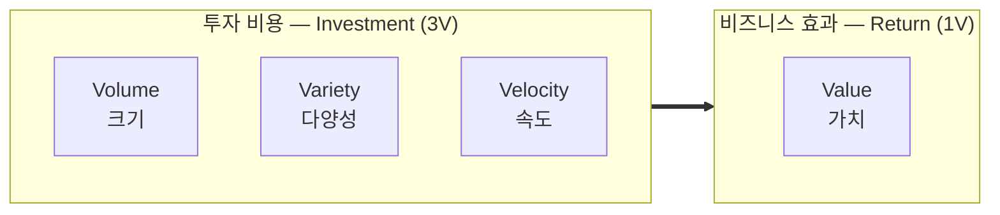
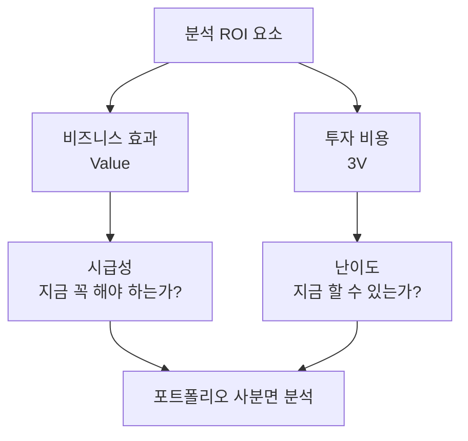
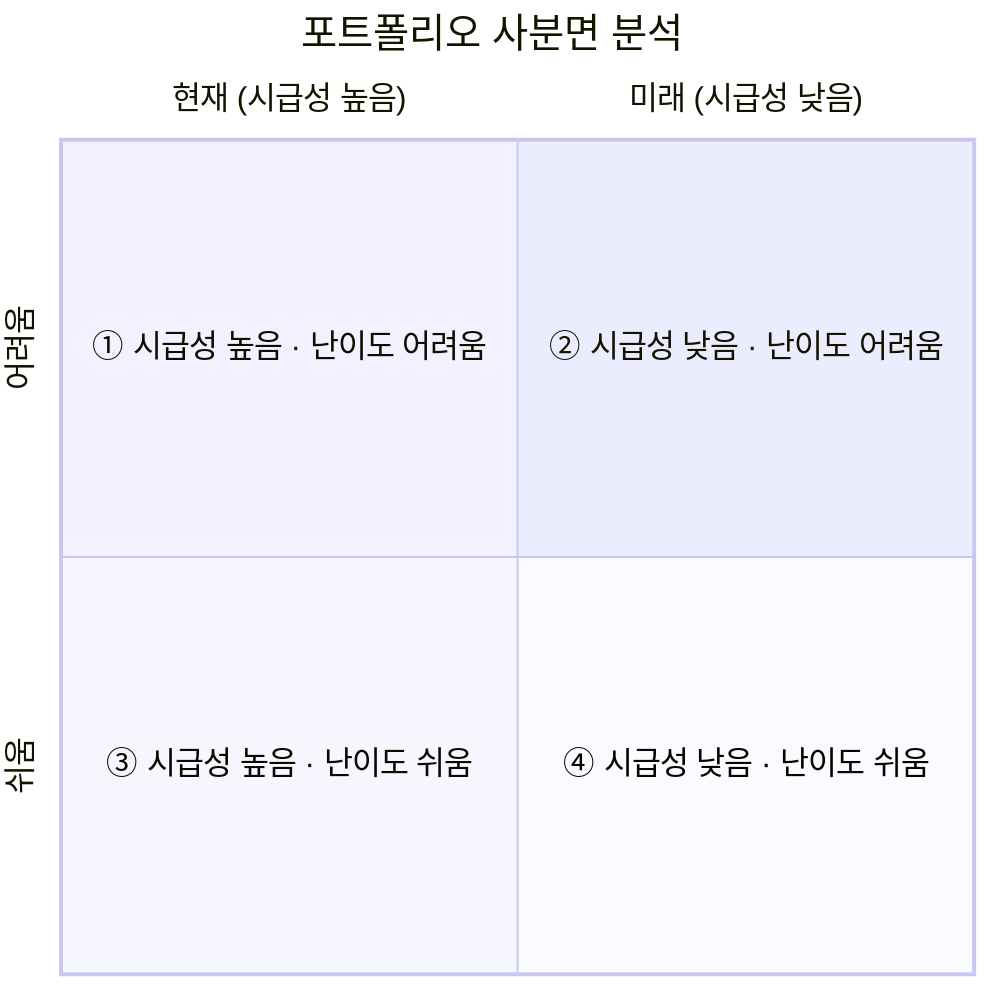
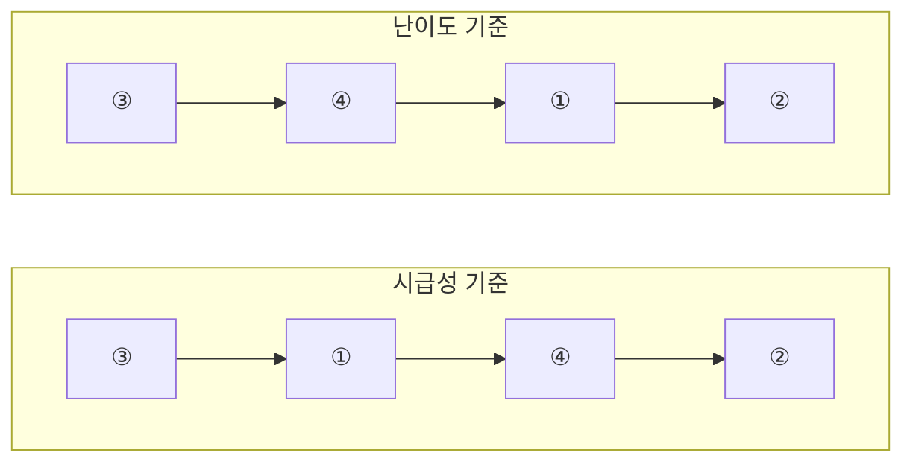

# 분석 마스터플랜

---

## 분석 마스터플랜의 개념

| 개념 | 정의 |
|---|---|
| **분석 마스터플랜** | 어떤 하나의 분석 프로젝트를 위한 **전체 설계도** (**분석 방법론**과 **과제 발굴 수행과정**을 모두 아우르는 개념) |

### 수립 단계에서 하는 일

| 순서 | 활동 |
|---|---|
| **1** | 분석 과제의 **우선순위**를 결정 |
| **2** | 기업의 상황을 고려하여 분석 과제의 **적용 범위 및 방식**을 결정 |
| **3** | 최종적으로 **분석 구현 로드맵**을 수립 |

> **핵심**: 마스터플랜은 "무엇을 먼저, 어디까지, 어떻게 할 것인가"를 정하는 전체 밑그림이다.

---

## 분석 마스터플랜 수립 프레임워크

일련의 과정을 **마스터플랜 수립 프레임워크**라 부른다.

### 1️⃣ 우선순위 결정 기준 ⭐

| 기준 | 설명 |
|---|---|
| **전략적 중요도** | 전략적 필요성과 시급성 관점에서의 중요도 |
| **비즈니스 성과 / ROI** | 분석을 통해 얻을 수 있는 **투자 수익률** |
| **분석 과제의 실행 용이성** | 실제로 수행 가능한지에 대한 난이도 |

> **ROI (Return On Investment)**: 투자 수익률. 투자한 비용 대비 얻은 이익의 비율

### 2️⃣ 적용 범위 및 방식 설정 ⭐

분석 과제의 우선순위와 **함께** 설정해야 하는 항목이다.

| 항목 | 결정 내용 |
|---|---|
| **업무 내재화 적용 수준** | 분석 과제를 **업무에 내재화할 것인지** 여부 |
| **분석 데이터 적용 수준** | 분석 데이터를 **내부 데이터로 한정**할 것인지, **외부 데이터까지 포함**할 것인지 여부 |
| **기술 적용 수준** | 어느 수준까지 기술을 적용할 것인지 |

### 3️⃣ 로드맵 수립

분석 과제의 **우선순위**와 **적용 범위 및 방식**을 종합적으로 고려하여 최종적으로 **분석 구현의 로드맵**을 수립한다.

---

## 수행 과제 도출 및 우선순위 평가

### 1️⃣ 일반적인 IT 프로젝트 우선순위 평가

| 항목 | 설명 |
|---|---|
| **평가 방식** | 전략적 중요도, 실행 용이성 등 기업에서 고려하는 **중요 가치 기준**에 따라 다양한 관점에서의 우선순위 기준을 수립하여 평가 |
| **고려 요소** | ① 전략적 중요도 ② 실행 용이성 ③ 비즈니스 성과 / ROI |

---

### 2️⃣ 빅데이터 특징을 고려한 분석 ROI 요소 ⭐

빅데이터의 특징인 **4V**를 ROI 관점에서 살펴보면 두 가지 측면으로 나뉜다.

| 4V | 명칭 | ROI 측면 |
|---|---|---|
| **Volume** | 크기 | 투자 비용 |
| **Variety** | 다양성 | 투자 비용 |
| **Velocity** | 속도 | 투자 비용 |
| **Value** | 가치 | **비즈니스 효과** |

> **핵심 암기**: **3V = 비용**, **Value = 효과**. 4V 중 Value만 효과 측면이다.

---

### 3️⃣ ROI를 활용한 우선순위 평가 기준 ⭐

ROI 요소를 **시급성**과 **난이도**라는 두 개의 판단 기준으로 나누어 평가한다.

| 판단 기준 | 대응 ROI 요소 | 세부 내용 |
|---|---|---|
| **시급성** | **비즈니스 효과 (Value)** | 전략적 중요도(기여도)가 핵심 판단 기준 **현재 관점**에 전략적 가치를 둘 것인지, **미래의 중장기적 관점**에 전략적 가치를 둘 것인지 등 **적정 시기**를 고려 분석 과제의 목표가치(**KPI**)를 함께 고려해 시급성 여부를 판단 |
| **난이도** | **투자 비용 (3V)** | 현시점에서 과제를 추진하는 것이 **적용 비용과 범위 측면**에서 바로 적용하기 쉬운지 어려운지의 판단 기준 **데이터 분석의 적합성 여부**를 따져 살펴봄 |

---

### 4️⃣ 포트폴리오 사분면 분석을 활용한 우선순위 평가 기준 ⭐

**난이도와 시급성을 동시에 고려**하여, 우선 추진해야 하는 분석 과제와 단기적 또는 중장기적으로 추진해야 하는 분석 과제 등 **4가지 유형**으로 구분해 적용 우선순위를 결정한다.

#### 사분면 구성

| 사분면 | 시급성 | 난이도 | 성격 |
|---|---|---|---|
| **①** | 높음 (현재) | 어려움 | 지금 필요하지만 추진이 어려움 |
| **②** | 낮음 (미래) | 어려움 | 가장 후순위, 중장기 과제 |
| **③** | 높음 (현재) | 쉬움 | **언제나 최우선** |
| **④** | 낮음 (미래) | 쉬움 | 쉽지만 급하지 않음 |

---

#### 우선순위 결정 순서

| 평가 기준 | 우선순위 순서 | 논리 |
|---|---|---|
| **시급성**에 둘 경우 | **③ → ① → ④ → ②** | 시급성 높은 것(③①)부터, 그 안에서 난이도 순 |
| **난이도**에 둘 경우 | **③ → ④ → ① → ②** | 난이도 쉬운 것(③④)부터, 그 안에서 시급성 순 |

#### 한국데이터산업진흥원 기준 (일부 생략)

| 평가 기준 | 생략 대상 | 우선순위 순서 |
|---|---|---|
| **시급성**에 둘 경우 | **①** 생략 | ③ → ④ → ② |
| **난이도**에 둘 경우 | **④** 생략 | ③ → ① → ② |

> **③은 어느 기준이든 항상 1순위, ②는 항상 마지막**이다. ①과 ④의 순서만 기준에 따라 바뀐다.

---

#### 우선순위는 절대적이지 않다

| 내용 |
|---|
| 위 순서는 **절대적인 것이 아니다** |
| 시급성이 높고 난이도도 높은 **①사분면**의 경우, **난이도를 낮추어** 가장 먼저 우선순위를 정할 수 있음 |
| 기술적인 난이도가 높더라도 이를 **조절하여** 우선순위를 결정할 수 있음 |
| 즉, **기업의 상황에 따라 탄력적으로 운용 가능**하다 |

> **핵심**: 사분면 분석은 가이드일 뿐, 난이도는 **조절 가능한 변수**다. 기업의 여건에 맞춰 유연하게 적용한다.

---

## 시험 대비 핵심 포인트

| 주제 | 핵심 내용 |
|---|---|
| **마스터플랜 정의** | 분석 프로젝트의 전체 설계도 (방법론 + 과제 발굴 아우름) |
| **프레임워크 3단계** | 우선순위 결정 → 적용 범위·방식 설정 → 로드맵 수립 |
| **우선순위 3기준** | 전략적 중요도 / 비즈니스 성과·ROI / 실행 용이성 |
| **적용 범위 3수준** | 업무 내재화 / 분석 데이터 / 기술 적용 |
| **ROI 관점 4V** | 3V(크기·다양성·속도) = 투자 비용 Value(가치) = 비즈니스 효과 |
| **ROI 평가 2기준** | 시급성 = 비즈니스 효과(Value) / 난이도 = 투자 비용(3V) |
| **시급성 판단 요소** | 전략적 중요도(기여도), 적정 시기(현재 vs 중장기), 목표가치(KPI) |
| **난이도 판단 요소** | 적용 비용, 범위, 데이터 분석의 적합성 |
| **사분면 우선순위** | 시급성 기준 ③→①→④→② 난이도 기준 ③→④→①→② |
| **진흥원 기준** | 시급성 기준 ③→④→② (① 생략) 난이도 기준 ③→①→② (④ 생략) |
| **탄력적 운용** | 난이도는 조절 가능 → 기업 상황에 따라 유연하게 적용 |
