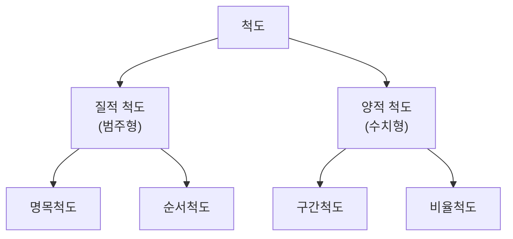

# 통계학 개론 ① 표본추출과 척도

> 3과목 데이터 분석 › 2장 통계분석

---

# 통계와 표본조사

## 통계의 이해

| 구분 | 정의 |
|---|---|
| **통계 (Statistics)** | 특정 집단을 대상으로 수행한 조사나 실험의 결과로 얻은<br>**수치 자료의 요약된 형태** |
| **통계학** | 자료로부터 유용한 정보를 이끌어 내는 학문으로,<br>자료의 **수집 · 분류 · 요약 · 분석 · 추론**을 다루는 학문 |
| **통계 분석** | 특정 집단이나 불확실한 현상을 대상으로 자료를 수집해,<br>**그 집단의 특성을 규명하거나 미래를 예측**하는 분석 |

---

## 기본 용어 ⭐

| 용어 | 정의 |
|---|---|
| **모집단 (Population)** | 조사하고자 하는 **대상 집단 전체** |
| **표본 (Sample)** | 모집단에서 **뽑아낸 일부** |
| **모수 (Parameter)** | **모집단**의 특성값 (모평균 μ, 모분산 σ²) |
| **통계량 (Statistic)** | **표본**의 특성값 (표본평균 x̄, 표본분산 s²) |
| **전수조사** | 모집단 **전체를 조사**하는 방법 |
| **표본조사** | 표본만 조사해 모집단을 **추론**하는 방법 |


> **핵심 구조**: 모집단에서 표본을 **추출**하고, 표본의 통계량으로 모집단의 모수를 **추론**한다.

---

## 표본조사

| 항목 | 내용 |
|---|---|
| **정의** | 조사 대상인 **모집단 전체가 아니라 일부(표본)를 추출**하여 조사한 뒤,<br>그 결과로 **모집단 전체의 특성을 추론**하는 조사 방법 |
| **표본 대표성** | 모집한 표본은 **집단 전체를 대변할 수 있는 표본 대표성**이 있어야 함 |
| **중요성** | 표본 대표성의 **신뢰 여부가 통계 전체의 신뢰에 영향**을 줄 수 있음 |

### 표본조사를 하는 이유

| 이유 | 설명 |
|---|---|
| **비용·시간 절감** | 전수조사는 막대한 비용과 시간이 소요됨 |
| **전수조사 불가** | 제품 파괴검사처럼 전체를 조사할 수 없는 경우가 존재 |
| **신속성** | 빠르게 결과를 얻어 의사결정에 활용 가능 |

> **주의**: 표본이 모집단을 제대로 대변하지 못하면(**표본 편향**) 아무리 정교하게 분석해도 결과를 신뢰할 수 없다.

### 표본오차와 비표본오차 ⭐

| 구분 | 의미 | 표본 크기를 늘리면 |
|---|---|---|
| **표본오차** | 모집단의 **일부만** 조사해서 생기는 오차 | **줄어듦** |
| **비표본오차** | 표본추출 외의 원인 — 조사 설계 잘못, 응답 오류, 입력 실수, 무응답 등 | 줄지 않고, 오히려 **늘 수 있음** |
| **표본편의** | 표본추출 방법 자체 때문에 생기는 **체계적 편향** | 줄지 않음 — **확률화**로 최소화 |

> 비표본오차는 **전수조사에서도 발생**한다. 표본오차는 전수조사에서는 없다.

---
---

# 표본 추출 방법 ⭐

| 방법 | 한 줄 요약 |
|---|---|
| **단순 랜덤 추출법** | 그냥 **무작위로** 뽑음 |
| **계통 추출법** | **일정한 간격**으로 뽑음 |
| **집락 추출법** | **집단을 통째로** 뽑음 |
| **층화 추출법** | **층으로 나눈 뒤 각 층에서** 뽑음 |

---

## 1️⃣ 단순 랜덤 추출법 (Simple Random Sampling)

| 항목 | 내용 |
|---|---|
| **방법** | 가장 쉽고 단순한 방법으로, **N개의 모집단에서 n개의 데이터를 무작위로 추출** |
| **특징** | 모든 데이터가 **뽑힐 확률이 동일** |

```
모집단: ① ② ③ ④ ⑤ ⑥ ⑦ ⑧ ⑨ ⑩
추출:      ②    ④       ⑦       ⑩     ← 무작위
```

```r
sample(1:100, 10)                    # 비복원 추출
sample(1:100, 10, replace = TRUE)    # 복원 추출
```

| 구분 | 설명 |
|---|---|
| **복원 추출** | 뽑은 것을 **다시 넣고** 뽑음 → 중복 가능 |
| **비복원 추출** | 뽑은 것을 **빼고** 뽑음 → 중복 없음 (R의 기본값) |

---

## 2️⃣ 계통 추출법 (Systematic Sampling)

| 항목 | 내용 |
|---|---|
| **방법** | 모집단의 데이터에 **번호를 부여**한 뒤,<br>**일정한 간격(K)**을 두고 데이터를 추출하는 방법 |
| **절차** | ① 모집단을 K개 구간으로 나눔<br>② **첫 구간에서 하나를 무작위로** 선택<br>③ 그 이후로는 **K만큼 건너뛰며** 추출 |
| **간격 K** | **K = N ÷ n** (모집단 크기 ÷ 표본 크기) |

```
모집단 100명에서 10명 추출 → K = 10
첫 번째로 3번을 뽑았다면
추출: ③ ⑬ ㉓ ㉝ ㊸ ...   ← 10씩 건너뜀
```

| 장점 | 단점 |
|---|---|
| 절차가 **간편**하고 표본이 고르게 분포 | 데이터에 **주기성**이 있으면 편향 발생 |

> **주기성 문제 예시**: 7일 간격으로 매출을 뽑으면 항상 같은 요일만 뽑혀 왜곡된다.

---

## 3️⃣ 집락 추출법 (Cluster Sampling)

| 항목 | 내용 |
|---|---|
| **방법** | 모집단을 여러 개의 **집락(cluster)으로 나눈 뒤**,<br>**일부 집락을 통째로 선택**하여 그 안의 데이터를 조사하는 방법 |
| **집락의 성격** | 각 집락이 **모집단을 축소한 형태** — 집락 **내부는 이질적**, **집락 간에는 동질적** |

```
전국 → 시·도별로 나눔 (집락)
→ 그중 3개 시·도를 통째로 선택 → 그 안의 전원 조사
```

| 장점 | 단점 |
|---|---|
| **비용과 시간이 절약**됨 (조사 지역이 좁아짐) | 집락 간 차이가 크면 **표본 대표성이 떨어짐** |

> **활용**: 전국 조사처럼 **모집단이 지역적으로 넓게 퍼져 있을 때** 유용하다.

---

## 4️⃣ 층화 추출법 (Stratified Sampling)

| 항목 | 내용 |
|---|---|
| **방법** | 모집단을 **서로 겹치지 않는 여러 개의 층(strata)으로 나눈 뒤**,<br>**각 층에서 표본을 무작위로 추출**하는 방법 |
| **층의 성격** | **층 내부는 동질적**, **층 간에는 이질적** |

```
전교생 → 학년별로 나눔 (층)
→ 1학년에서 10명, 2학년에서 10명, 3학년에서 10명 추출
```

| 구분 | 설명 |
|---|---|
| **비례 층화 추출** | 각 층의 **크기에 비례**하여 표본 수를 배분 |
| **불비례 층화 추출** | 층의 크기와 무관하게 배분 |

| 장점 | 단점 |
|---|---|
| **표본 대표성이 높음**, 층별 비교 가능 | 층을 나누기 위한 **사전 정보가 필요** |

---

## 집락 추출법 vs 층화 추출법 ⭐

가장 헷갈리는 두 방법이다. **집단 내부와 집단 간의 성질**이 정반대다.

| 구분 | 집락 추출법 | 층화 추출법 |
|---|---|---|
| **집단 내부** | **이질적** (다양하게 섞임) | **동질적** (비슷한 것끼리) |
| **집단 간** | **동질적** (집락끼리 비슷) | **이질적** (층끼리 다름) |
| **추출 방식** | **일부 집단을 통째로** 선택 | **모든 집단에서 조금씩** 추출 |
| **목적** | 비용·시간 절약 | 표본 대표성 확보 |
| **예시** | 전국에서 3개 시·도만 선택해 전수조사 | 학년별로 나눠 각 학년에서 10명씩 |

> **구분 요령**: 집락은 **"몇 개 덩어리만 골라서 전부"**, 층화는 **"모든 층에서 조금씩"**

---

## 확률 표본추출 vs 비확률 표본추출

| 구분 | 확률 표본추출 | 비확률 표본추출 |
|---|---|---|
| 원리 | 모든 대상이 뽑힐 확률을 **알 수 있음** | 조사자의 편의·판단에 의존 |
| 방법 | 단순 랜덤, 계통, 집락, 층화 | 편의 추출, 판단 추출, 할당 추출, 눈덩이 추출 |
| 일반화 | 모집단 추론 가능 | 대표성 보장 어려움 |

| 비확률 방법 | 설명 |
|---|---|
| 편의 추출 | 쉽게 접근 가능한 대상 위주 (길거리 설문) |
| 판단 추출 | 조사자가 적합하다고 판단한 대상 |
| 할당 추출 | 성별·연령 등 비율을 정해 놓고 그 안에서 편의대로 |
| 눈덩이 추출 | 응답자가 다음 응답자를 소개 |

> **층화 추출 vs 할당 추출**: 둘 다 집단을 나누지만, 층화는 각 층 안에서 **무작위**, 할당은 **조사자 임의**로 뽑는다.

---
---

# 측정과 척도

| 구분 | 개념 |
|---|---|
| **측정** | 조사 대상의 특성을 **일정한 규칙에 따라 수치나 기호로 부여**하는 것 |
| **척도** | 측정할 때 사용하는 **기준 또는 도구** |

## 척도의 종류



## 척도별 특성 비교 ⭐

| 구분 | 척도 | 범주 | 순서 | 상대적 크기<br>(간격) | 절대적 크기<br>(절대 0) |
|---|---|:---:|:---:|:---:|:---:|
| **질적 척도** | **명목척도** | ✅ | ❌ | ❌ | ❌ |
| **질적 척도** | **순서척도** | ✅ | ✅ | ❌ | ❌ |
| **양적 척도** | **구간척도** | ✅ | ✅ | ✅ | ❌ |
| **양적 척도** | **비율척도** | ✅ | ✅ | ✅ | ✅ |

> **누적 구조**: 아래로 갈수록 **성질이 하나씩 추가**된다. 비율척도가 가장 많은 정보를 담는다.

## 척도별 상세

| 척도 | 정의 | 예시 |
|---|---|---|
| **명목척도** | 대상을 **단순히 분류·구분**하기 위한 척도<br>숫자를 부여해도 크기의 의미가 없음 | 성별, 혈액형, 지역, 종교<br>전화번호, 등번호 |
| **순서척도**<br>(서열척도) | **순위·서열**을 매길 수 있는 척도<br>단, 간격이 일정하지 않음 | 학점(A/B/C), 만족도(상/중/하)<br>선호도, 신용등급, 석차 |
| **구간척도**<br>(등간척도) | 순서에 더해 **간격이 동일**한 척도<br>**절대 0점이 없어** 비율 계산 불가 | 온도(℃), IQ, 연도<br>시험 점수 |
| **비율척도** | 구간척도에 더해 **절대 0점이 존재**<br>덧셈·뺄셈·곱셈·나눗셈 모두 가능 | 키, 몸무게, 나이, 매출액<br>거리, 시간 |

## 구간척도 vs 비율척도 ⭐

가장 헷갈리는 두 척도. 구분 기준은 **"0이 진짜 없음을 뜻하는가"**다.

| 구분 | 구간척도 | 비율척도 |
|---|---|---|
| **절대 0** | 없음 (**임의로 정한 0**) | 있음 (**없음을 의미**) |
| **비율 계산** | 불가능 | 가능 |
| **예시** | 섭씨 0도 = 추운 온도 (온도 없음 ❌) | 0kg = 무게 없음 ⭕ |
| **판단** | 20℃는 10℃의 **2배가 아님** | 20kg은 10kg의 **2배가 맞음** |

---
---

# 기술 통계와 추리 통계

## 기술 통계 (Descriptive Statistics)

| 항목 | 내용 |
|---|---|
| **정의** | **표본 자체의 속성이나 특징을 파악**하는 데 중점을 두는 데이터 분석 통계 |
| **역할** | 자료를 **요약하고 조직화, 단순화**함 |
| **기술 통계량** | 표본조사 이후 표본을 설명해주는 데이터의<br>**최솟값, 최댓값, 중위수** 등의 통계량<br>→ **모집단의 특성을 유추하는 데 사용** |

```r
summary(iris)       # 대표적인 기술통계 출력
mean(x); median(x); sd(x)
```

---

## 추리 통계 (Inferential Statistics)

| 항목 | 내용 |
|---|---|
| **정의** | 수집한 데이터를 바탕으로 **추론 및 예측**하는 통계 기법 |
| **방법** | 표본에서 얻은 통계치를 바탕으로 **오차를 고려하면서**<br>**모수를 확률적으로 추정**하는 통계 기법 |
| **초점** | 표본에서 얻은 통계치로 **모집단의 특성을 추정**하는 데 초점을 두고<br>**가설을 검증**하거나 **확률적인 가능성을 파악** |
| **활용** | 이를 통해 **향후 발생할 수 있는 사건을 예측** 가능 |

---

## 두 통계 비교 ⭐

| 구분 | 기술 통계 | 추리 통계 |
|---|---|---|
| **대상** | **표본 자체** | **모집단** |
| **목적** | 요약 · 정리 · 설명 | 추정 · 검정 · 예측 |
| **오차 개념** | 없음 | **오차를 고려** |
| **결과** | 확정적 (사실 그대로) | 확률적 (~일 것이다) |
| **예시** | 평균, 중앙값, 표준편차, 그래프 | 신뢰구간, 가설검정, 회귀분석 |


> **관계**: 기술 통계로 **표본을 정리**한 뒤, 그 결과를 바탕으로 추리 통계가 **모집단을 추론**한다.
