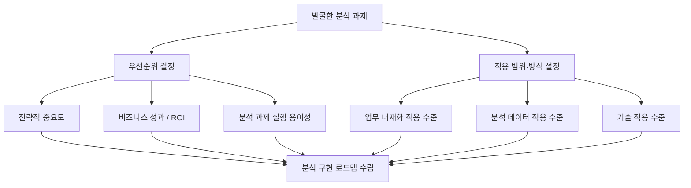
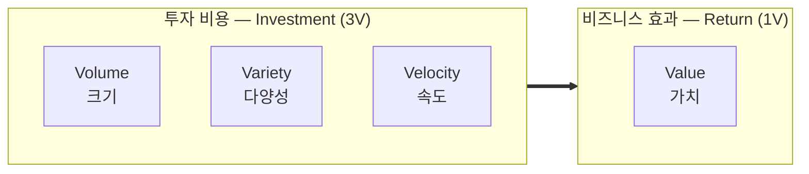
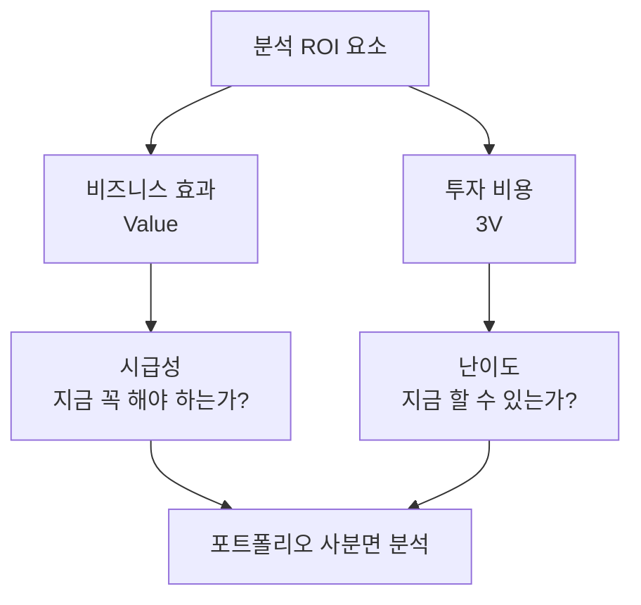
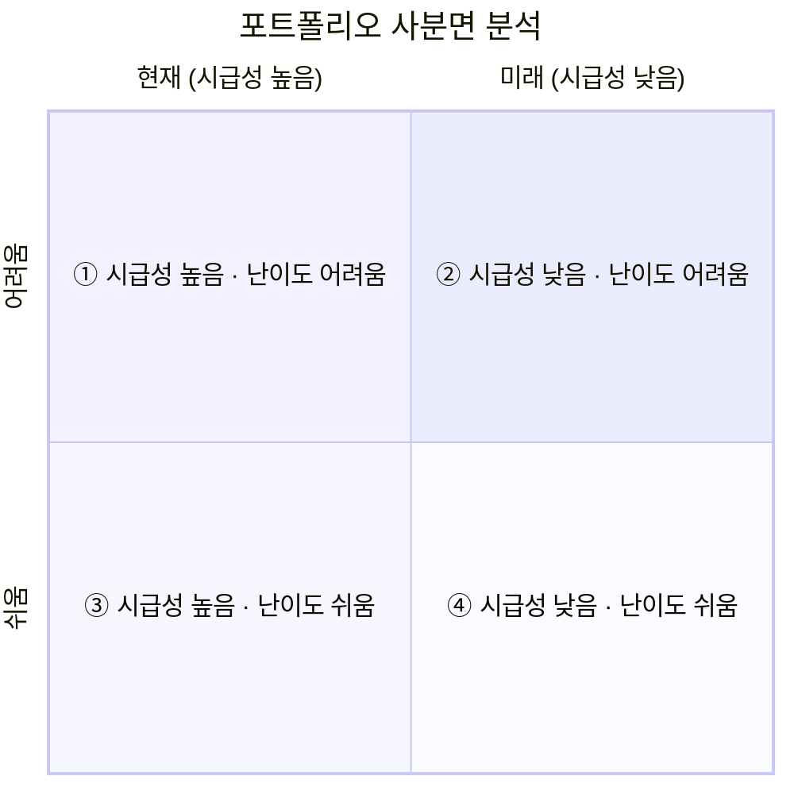
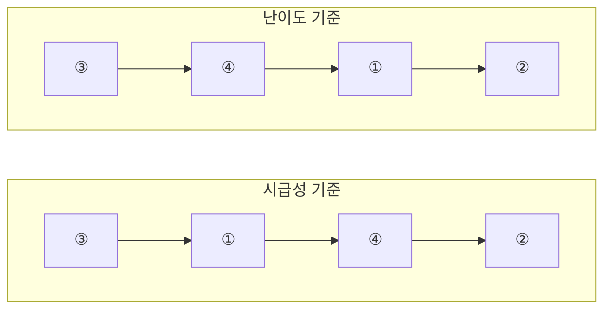
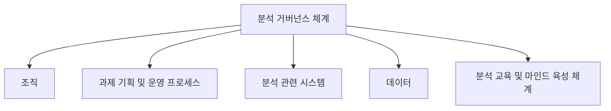
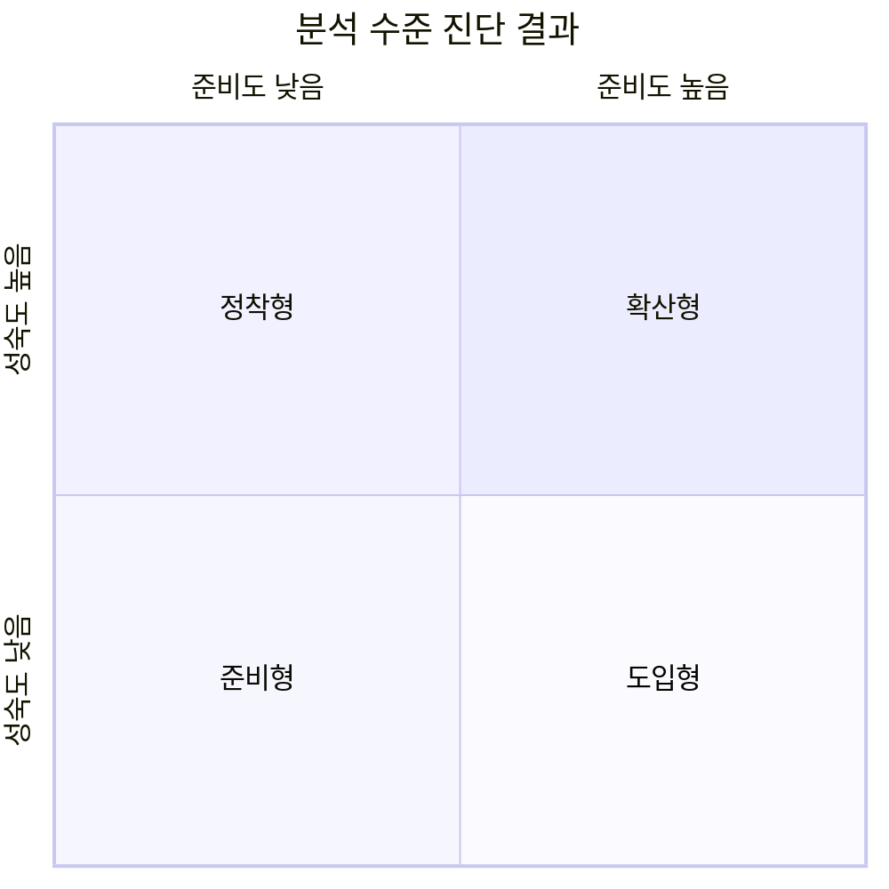

# 분석 마스터플랜

---

## 분석 마스터플랜의 개념

| 개념 | 정의 |
|---|---|
| **분석 마스터플랜** | 어떤 하나의 분석 프로젝트를 위한 **전체 설계도** (**분석 방법론**과 **과제 발굴 수행과정**을 모두 아우르는 개념) |

### 수립 단계에서 하는 일

| 순서 | 활동 |
|---|---|
| **1** | 분석 과제의 **우선순위**를 결정 |
| **2** | 기업의 상황을 고려하여 분석 과제의 **적용 범위 및 방식**을 결정 |
| **3** | 최종적으로 **분석 구현 로드맵**을 수립 |

> **핵심**: 마스터플랜은 "무엇을 먼저, 어디까지, 어떻게 할 것인가"를 정하는 전체 밑그림이다.

---

## 분석 마스터플랜 수립 프레임워크

일련의 과정을 **마스터플랜 수립 프레임워크**라 부른다.

### 1️⃣ 우선순위 결정 기준 ⭐

| 기준 | 설명 |
|---|---|
| **전략적 중요도** | 전략적 필요성과 시급성 관점에서의 중요도 |
| **비즈니스 성과 / ROI** | 분석을 통해 얻을 수 있는 **투자 수익률** |
| **분석 과제의 실행 용이성** | 실제로 수행 가능한지에 대한 난이도 |

> **ROI (Return On Investment)**: 투자 수익률. 투자한 비용 대비 얻은 이익의 비율

### 2️⃣ 적용 범위 및 방식 설정 ⭐

분석 과제의 우선순위와 **함께** 설정해야 하는 항목이다.

| 항목 | 결정 내용 |
|---|---|
| **업무 내재화 적용 수준** | 분석 과제를 **업무에 내재화할 것인지** 여부 |
| **분석 데이터 적용 수준** | 분석 데이터를 **내부 데이터로 한정**할 것인지, **외부 데이터까지 포함**할 것인지 여부 |
| **기술 적용 수준** | 어느 수준까지 기술을 적용할 것인지 |

### 3️⃣ 로드맵 수립

분석 과제의 **우선순위**와 **적용 범위 및 방식**을 종합적으로 고려하여 최종적으로 **분석 구현의 로드맵**을 수립한다.

---

## 수행 과제 도출 및 우선순위 평가

### 1️⃣ 일반적인 IT 프로젝트 우선순위 평가

| 항목 | 설명 |
|---|---|
| **평가 방식** | 전략적 중요도, 실행 용이성 등 기업에서 고려하는 **중요 가치 기준**에 따라 다양한 관점에서의 우선순위 기준을 수립하여 평가 |
| **고려 요소** | ① 전략적 중요도 ② 실행 용이성 ③ 비즈니스 성과 / ROI |

---

### 2️⃣ 빅데이터 특징을 고려한 분석 ROI 요소 ⭐

빅데이터의 특징인 **4V**를 ROI 관점에서 살펴보면 두 가지 측면으로 나뉜다.

| 4V | 명칭 | ROI 측면 |
|---|---|---|
| **Volume** | 크기 | 투자 비용 |
| **Variety** | 다양성 | 투자 비용 |
| **Velocity** | 속도 | 투자 비용 |
| **Value** | 가치 | **비즈니스 효과** |

> **핵심 암기**: **3V = 비용**, **Value = 효과**. 4V 중 Value만 효과 측면이다.

---

### 3️⃣ ROI를 활용한 우선순위 평가 기준 ⭐

ROI 요소를 **시급성**과 **난이도**라는 두 개의 판단 기준으로 나누어 평가한다.

| 판단 기준 | 대응 ROI 요소 | 세부 내용 |
|---|---|---|
| **시급성** | **비즈니스 효과 (Value)** | 전략적 중요도(기여도)가 핵심 판단 기준 **현재 관점**에 전략적 가치를 둘 것인지, **미래의 중장기적 관점**에 전략적 가치를 둘 것인지 등 **적정 시기**를 고려 분석 과제의 목표가치(**KPI**)를 함께 고려해 시급성 여부를 판단 |
| **난이도** | **투자 비용 (3V)** | 현시점에서 과제를 추진하는 것이 **적용 비용과 범위 측면**에서 바로 적용하기 쉬운지 어려운지의 판단 기준 **데이터 분석의 적합성 여부**를 따져 살펴봄 |

---

### 4️⃣ 포트폴리오 사분면 분석을 활용한 우선순위 평가 기준 ⭐

**난이도와 시급성을 동시에 고려**하여, 우선 추진해야 하는 분석 과제와 단기적 또는 중장기적으로 추진해야 하는 분석 과제 등 **4가지 유형**으로 구분해 적용 우선순위를 결정한다.

#### 사분면 구성

| 사분면 | 시급성 | 난이도 | 성격 |
|---|---|---|---|
| **①** | 높음 (현재) | 어려움 | 지금 필요하지만 추진이 어려움 |
| **②** | 낮음 (미래) | 어려움 | 가장 후순위, 중장기 과제 |
| **③** | 높음 (현재) | 쉬움 | **언제나 최우선** |
| **④** | 낮음 (미래) | 쉬움 | 쉽지만 급하지 않음 |

#### 우선순위 결정 순서

| 평가 기준 | 우선순위 순서 | 논리 |
|---|---|---|
| **시급성**에 둘 경우 | **③ → ① → ④ → ②** | 시급성 높은 것(③①)부터, 그 안에서 난이도 순 |
| **난이도**에 둘 경우 | **③ → ④ → ① → ②** | 난이도 쉬운 것(③④)부터, 그 안에서 시급성 순 |

#### 한국데이터산업진흥원 기준 (일부 생략)

| 평가 기준 | 생략 대상 | 우선순위 순서 |
|---|---|---|
| **시급성**에 둘 경우 | **①** 생략 | ③ → ④ → ② |
| **난이도**에 둘 경우 | **④** 생략 | ③ → ① → ② |

> **③은 어느 기준이든 항상 1순위, ②는 항상 마지막**이다. ①과 ④의 순서만 기준에 따라 바뀐다.

#### 우선순위는 절대적이지 않다

| 내용 |
|---|
| 위 순서는 **절대적인 것이 아니다** |
| 시급성이 높고 난이도도 높은 **①사분면**의 경우, **난이도를 낮추어** 가장 먼저 우선순위를 정할 수 있음 |
| 기술적인 난이도가 높더라도 이를 **조절하여** 우선순위를 결정할 수 있음 |
| 즉, **기업의 상황에 따라 탄력적으로 운용 가능**하다 |

> **핵심**: 사분면 분석은 가이드일 뿐, 난이도는 **조절 가능한 변수**다.

---

## 단계적 구현 로드맵 수립 ⭐

| 항목 | 내용 |
|---|---|
| **정의** | 포트폴리오 사분면 분석을 통해 결정된 **과제의 우선순위**를 토대로, 분석 과제별 **적용 범위 및 방식**을 고려하여 **최종 우선순위를 결정**한 뒤 **단계적 구현 로드맵**을 수립 |
| **수립 방법** | 단계별로 추진하고자 하는 **목표를 명확히 정의**한 뒤, 과제별 **선·후행 관계**를 고려하여 단계별 추진 내용을 정렬 |

| 단계 | 명칭 | 추진 목표 | 주요 활동 |
|---|---|---|---|
| **1단계** | **분석 체계 도입** | 분석 기회 발굴 분석 과제 정의 분석 로드맵 수립 | 분석 기회 발굴 및 과제 정의 분석 로드맵 수립 |
| **2단계** | **분석 유효성 검증** | 분석 과제 수행 성과 검증 분석 아키텍처 설계 | 알고리즘 및 아키텍처 설계 분석 과제 Pilot 수행 |
| **3단계** | **분석 확산 및 고도화** | 분석 과제를 업무 프로세스에 내재화 검증 결과 확산 활용 시스템 구축 및 고도화 | 업무 프로세스 내재화를 위한 PI 관리 빅데이터 분석 활용 시스템 구축 유관 시스템 고도화 |

> **흐름**: 도입(준비) → 검증(작게 해보기) → 확산(전사 적용). 앞서 배운 **Quick & Win으로 신뢰를 얻고 마스터플랜으로 확장**하는 구조와 같은 논리다.

---

## 세부 이행계획 수립

| 항목 | 내용 |
|---|---|
| **적용 방식** | 고전적인 **폭포수 방식**도 있으나, **프로토타입**과 같이 반복적인 모델링 과정을 수행하여 프로젝트의 완성도를 높이는 방식이 **권장**됨 |
| **실무 적용** | 모든 과정을 반복하기보다는 **모델링 단계를 반복적으로 수행**하는 **혼합형**을 많이 적용 |
| **일정 계획** | 위 특성을 고려하여 **세부적인 일정 계획**도 함께 수립 |

> **핵심**: 전 과정을 반복하는 것이 아니라 **모델링 단계만 반복**하는 혼합형이 실무의 표준이다.

---
---

# 분석 거버넌스 체계

## 분석 거버넌스의 개념

| 개념 | 정의 |
|---|---|
| **거버넌스 (Governance)** | **통치**를 뜻하는 용어 |
| **분석 거버넌스** | 기업에서 의사결정을 위한 **데이터의 분석과 활용을 위한 체계적인 관리** |

| 항목 | 설명 |
|---|---|
| **목적** | 단순히 대용량 데이터를 수집·축적하는 것이 아니라, **어떤 목적으로 어떤 분석을 수행할지**, 분석을 위해 **어떻게 데이터를 활용할지** 결정 |
| **지향점** | 데이터 분석을 **기업의 문화로 정착**시키고, 데이터 분석 업무를 **고도화**하기 위해 데이터 관리 체계를 수립하는 것 |

### 분석 거버넌스 체계 구성요소 ⭐

| 구성요소 | 내용 |
|---|---|
| **조직 (Organization)** | 분석 기획 및 관리를 수행 |
| **과제 기획 및 운영 프로세스 (Process)** | 분석 과제의 발굴·기획·운영 절차 |
| **분석 관련 시스템 (System)** | 분석을 지원하는 IT 인프라 및 플랫폼 |
| **데이터 (Data)** | 분석에 활용되는 데이터와 그 관리 체계 |
| **분석 교육 및 마인드 육성 체계 (Human Resource)** | 분석 관련 교육과 조직 구성원의 분석 마인드 육성 |

> **암기 요령**: **조직 · 프로세스 · 시스템 · 데이터 · 교육** 5가지

---

## 분석 수준 진단 프레임워크

| 항목 | 설명 |
|---|---|
| **배경** | 데이터를 **어떻게 활용하느냐가 기업의 경쟁력을 좌우**함 |
| **필요성** | 기업은 데이터 분석의 **도입 여부와 활용 여부**에 대한 분석 수준을 점검하고 고도화할 필요가 있음 |
| **진단 방법** | **분석 준비도**와 **분석 성숙도**를 통해 데이터 분석 수준을 진단 |
| **활용** | 데이터 분석 기반을 구현하기 위해 어떤 준비를 해야 하는지 등 **분석의 유형 및 분석의 방향성**을 결정할 수 있음 |

---

### 1️⃣ 분석 준비도 (Readiness)

| 항목 | 내용 |
|---|---|
| **정의** | 기업의 **데이터 분석 역량을 파악**하는 방법 |
| **진단 영역** | **6가지 영역**을 대상으로 수준을 파악 |

| 진단 영역 | 진단 내용 |
|---|---|
| **분석 업무** | 어떤 분석 업무를 수행하고 있는가 |
| **분석 기법** | 업무에 적합한 분석 기법을 사용하는가 |
| **분석 데이터** | 분석에 필요한 데이터를 확보·관리하는가 |
| **분석 인력 및 조직** | 분석 전문 인력과 전담 조직이 있는가 |
| **분석 문화** | 데이터 기반 의사결정 문화가 정착되었는가 |
| **분석 인프라** | 분석을 지원할 IT 시스템과 기술이 갖춰졌는가 |

> **암기 요령**: **업무 · 기법 · 데이터 · 인력조직 · 문화 · 인프라** 6가지

---

### 2️⃣ 분석 성숙도 (Maturity)

| 항목 | 내용 |
|---|---|
| **참조 모델** | 소프트웨어 분야의 성숙도 평가 모델인 **CMMI**를 활용 |
| **진단 부문** | **비즈니스 부문 / 조직·역량 부문 / IT 부문**의 **3개 부문** |
| **성숙도 단계** | **도입 → 활용 → 확산 → 최적화**의 4단계 |

#### 분석 성숙도 평가표 ⭐

| 단계 | 설명 | 비즈니스 부문 | 조직 · 역량 부문 | IT 부문 |
|---|---|---|---|---|
| **1단계 도입** | 분석을 **시작**하여 환경과 시스템을 구축 | 실적 분석 및 통계 정기 보고 수행 운영 데이터 기반 | 일부 부서에서 수행 담당자 역량에 의존 | 데이터 웨어하우스 데이터 마트 ETL / EAI OLAP |
| **2단계 활용** | 분석 결과를 **실제 업무에 적용** | 미래 결과 예측 시뮬레이션 운영 데이터 기반 | 전문 담당 부서에서 수행 분석 기법 도입 관리자가 분석 수행 | 실시간 대시보드 통계 분석 환경 |
| **3단계 확산** | **전사 차원**에서 분석을 관리·공유 | 전사 성과 실시간 분석 프로세스 혁신 3.0 분석 규칙 관리 이벤트 관리 | 전사 모든 부서 수행 분석 COE 조직 운영 데이터 사이언티스트 확보 | 빅데이터 관리 환경 시뮬레이션·최적화 비주얼 분석 분석 전용 서버 |
| **4단계 최적화** | 분석을 **진화**시켜 혁신 및 성과 향상 | 외부 환경 분석 활용 최적화 업무 적용 실시간 분석 비즈니스 모델 진화 | 데이터 사이언스 그룹 경영진 의사결정 활용 전략 도구로 활용 | 분석 협업 환경 분석 SandBox 프로세스 내재화 빅데이터 분석 |

> **흐름 이해**: 도입(보고서 수준) → 활용(예측 시작) → 확산(전사 공유) → 최적화(전략 도구화)

---

### 3️⃣ 분석 수준 진단 결과 ⭐

| 항목 | 내용 |
|---|---|
| **활용 방법** | 기업의 분석 준비도와 성숙도 결과를 토대로 **유관 업종 또는 경쟁사의 분석 수준과 비교**하여 분석 기술 강화를 위한 **목표 수준을 설정** |
| **구분** | **4가지 유형**으로 분석 결과를 구분해 향후 개선 방향 등을 선정 |

| 유형 | 준비도 | 성숙도 | 의미 |
|---|---|---|---|
| **준비형** | 낮음 | 낮음 | 데이터·인력·조직·분석 업무 등이 **전반적으로 미흡** → 사전 준비부터 필요 |
| **정착형** | 낮음 | 높음 | 준비도는 낮지만 **일부 부서에서 분석이 이미 이뤄지고 있음** → 분석의 **일차적 정착** 상태 |
| **도입형** | 높음 | 낮음 | 조직·인력 등 **기반은 갖췄으나 분석 역량이 부족** → 바로 **분석을 도입**하면 됨 |
| **확산형** | 높음 | 높음 | 6개 준비도 영역을 **모두 갖추고 지속 확산 중** → 가장 성숙한 단계 |

> **헷갈림 방지**: **도입형**은 "도입할 **준비**가 됐다" → 준비도 높음. **정착형**은 "이미 일부는 하고 있다" → 성숙도 높음. 이 둘을 뒤바꾸는 것이 단골 함정이다.

---

## 분석 지원 인프라 방안 수립

### 플랫폼으로 인프라 구축

| 항목 | 내용 |
|---|---|
| **개별 구축의 문제** | 분석 과제 단위별로 별도의 분석 시스템을 구축하는 경우, **관리의 복잡도 및 비용 증가**라는 부작용 발생 |
| **권장 방향** | 분석 마스터플랜을 **기획하는 단계부터** 장기적·안정적으로 활용할 수 있는 **확장성을 고려한 플랫폼 구조**를 도입하는 것이 적절 |

### 개별 시스템 vs 플랫폼 구조 ⭐

| 구분 | 개별 시스템 | 플랫폼 구조 |
|---|---|---|
| **데이터 교환** | 시스템 간 **자체적인** 데이터 교환 | 분석 플랫폼을 활용한 **공통 기능 활용** |
| **데이터 관리** | 시스템별 **독립적인** 데이터 관리 | **중앙 집중적** 데이터 관리 |
| **확장 시** | 시스템 간 **인터페이스 폭증** | 시스템 간 **인터페이스 최소화** |

> **핵심**: 분석 과제가 늘어날수록 개별 시스템은 감당이 안 된다. **플랫폼 구조가 권장 방향**이다.

---
---

# 데이터 거버넌스 체계

## 데이터 거버넌스의 개념

| 항목 | 내용 |
|---|---|
| **정의** | 기업의 모든 데이터에 대해 **정책 및 지침, 표준화, 운영 조직 및 책임** 등의 표준화된 관리 체계를 수립하고, 운영을 위한 **프레임워크 및 저장소**를 구축하는 것 |
| **주요 관리 대상** | **마스터 데이터, 메타데이터, 데이터 사전** |

### 데이터 거버넌스 구성요소 ⭐

| 구성요소 | 내용 |
|---|---|
| **원칙 (Principle)** | 데이터를 유지·관리하기 위한 **지침과 가이드** |
| **조직 (Organization)** | 데이터를 관리할 조직의 **역할과 책임** |
| **프로세스 (Process)** | 데이터 관리를 위한 **활동과 체계** |

> **암기 요령**: **원칙 · 조직 · 프로세스** 3가지 (분석 거버넌스 5요소와 구분할 것)

---

## 데이터 거버넌스 체계

### 1️⃣ 데이터 표준화

| 항목 | 내용 |
|---|---|
| **구성 업무** | 데이터 표준 용어 설정, **명명 규칙 수립**, **메타데이터 구축**, **데이터 사전 구축** |

> **데이터 표준 용어**: **표준 단어 사전, 표준 도메인 사전, 표준 코드** 등으로 구성되며, 사전 간 **상호 검증이 가능하도록 점검 프로세스를 포함**한다.

### 2️⃣ 데이터 관리 체계

| 항목 | 내용 |
|---|---|
| **원칙 수립** | **데이터 정합성 및 활용의 효율성**을 위하여 표준 데이터를 포함한 **메타데이터와 데이터 사전의 관리 원칙**을 수립 |
| **상세화** | 수립된 원칙에 근거하여 항목별 **상세 프로세스**를 만들고, 관리·운영을 위한 **담당자 및 조직별 역할과 책임**을 상세하게 준비 |
| **빅데이터 유의사항** | 데이터 양의 급증으로 **데이터 생명주기 관리 방안**을 수립하지 않으면 **데이터 가용성 및 관리 비용 증대** 문제에 직면 |

### 3️⃣ 데이터 저장소 관리

| 항목 | 내용 |
|---|---|
| **구성** | 메타데이터 및 표준 데이터를 관리하기 위한 **전사 차원의 저장소**를 구성 |
| **지원 기능** | 데이터 관리 체계 지원을 위한 **워크플로 및 관리용 응용 소프트웨어**를 지원하고, 관리 대상 시스템과의 **인터페이스를 통한 통제** 수행 |
| **영향 평가** | **데이터 구조 변경에 따른 사전 영향 평가**도 수행되어야 효율적인 활용이 가능 |

### 4️⃣ 표준화 활동

| 항목 | 내용 |
|---|---|
| **점검** | 데이터 거버넌스 체계를 구축한 후 **표준 준수 여부를 주기적으로 점검**하고 모니터링 실시 |
| **정착** | 거버넌스의 조직 내 안정적인 정착을 위한 **지속적인 변화 관리 및 주기적인 교육** 진행 |
| **개선** | **지속적인 데이터 표준화 개선활동**을 통해 실용성을 높여야 함 |

---
---

# 데이터 조직 및 인력방안 수립

## 데이터 분석 조직

| 항목 | 내용 |
|---|---|
| **역할** | 기업 내에 존재하는 **빅데이터 속에서 가치를 찾아 전파하고 이를 행동화**하는 역할 수행 |
| **구성** | 분석 방법에 대한 **지식과 분석 경험을 가진 인력**으로 구성 |
| **목표** | 기업의 경쟁력 확보를 위해 **비즈니스 질문에 부합하는 가치를 찾고 비즈니스를 최적화**하는 것 |

---

## 조직 및 인력 구성 시 고려사항 ⭐

### 조직 구조 관점

| 고려사항 |
|---|
| 비즈니스 질문을 **선제적으로 찾아낼 수 있는 구조**인가 |
| 분석 전담 조직과 **타 부서 간 유기적인 협조와 지원**이 원활한 구조인가 |
| 효율적인 분석 업무 수행을 위한 **분석 조직의 내부 조직 구조**는 어떠한가 |
| 전사 및 단위 부서가 필요할 경우 **접촉하며 지원할 수 있는 구조**인가 |
| **어떤 형태의 조직**으로 구성하는 것이 효율적인가 |

### 인력 구성 관점

| 고려사항 |
|---|
| **비즈니스 및 IT 전문가의 조합**으로 구성되어야 하는가 |
| **어떤 경험과 스킬**을 갖춘 사람으로 구성해야 하는가 |
| **통계적 기법 및 분석 모델링 전문 인력**을 별도로 구성해야 하는가 |
| 전사 비즈니스를 커버하는 인력이 없다면 어떻게 할 것인가 |
| 전사 분석 업무에 대한 **적합한 인력 규모**는 어느 정도인가 |

> **핵심**: 조직 구조는 "**어떻게 배치할 것인가**", 인력 구성은 "**누구를 얼마나 둘 것인가**"의 문제다.

---

