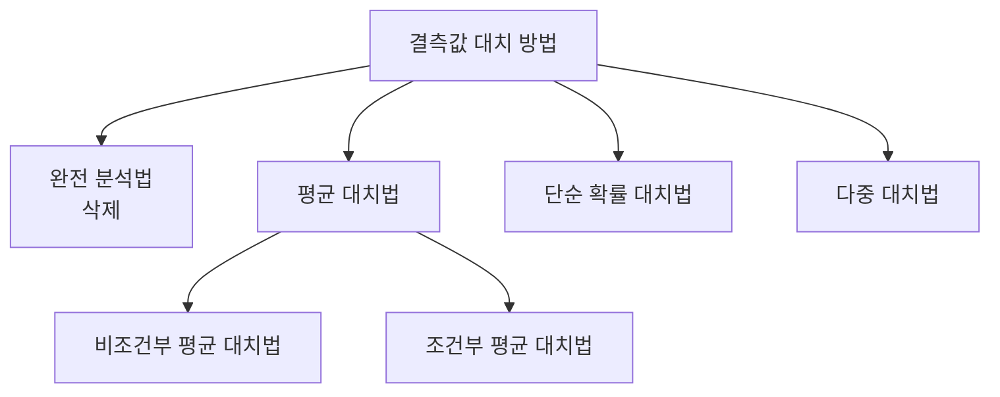

# 탐색적 데이터 분석 (EDA)

| 항목 | 내용 |
|---|---|
| **정의** | 데이터를 이해하고 **의미 있는 관계를 찾아내기 위해**<br>데이터의 **통곗값과 분포 등을 시각화하고 분석**하는 것 |
| **목적** | 데이터 특성을 이해하고, 이를 토대로 **모델을 구축**할 수 있음 |

> **EDA (Exploratory Data Analysis)**: 분석에 앞서 데이터가 어떻게 생겼는지 먼저 살펴보는 과정. 앞서 배운 **상향식 접근법**과 맥이 닿아 있다.

---

## EDA의 4가지 주제 ⭐

| 주제 | 설명 |
|---|---|
| **저항성 (Resistance)** | 일부 데이터가 오류·이상값이어도 **분석 결과가 크게 영향받지 않는 성질** |
| **잔차 해석 (Residual)** | 관찰값이 주 경향에서 얼마나 벗어났는지 **살펴보는 것** |
| **자료 재표현 (Re-expression)** | 데이터를 **로그·제곱근 등으로 변환**하여 해석을 쉽게 만드는 것 |
| **현시성 (Graphical Representation)** | 데이터를 **시각화**하여 자료 안의 정보를 드러내는 것 |

---

## 붓꽃(iris) 데이터를 이용한 EDA 예시

R에 내장된 대표적인 실습 데이터로, **붓꽃 150개의 꽃받침·꽃잎 크기와 품종**이 담겨 있다.

| 변수 | 의미 | 타입 |
|---|---|---|
| **Sepal.Length** | 꽃받침 길이 | numeric |
| **Sepal.Width** | 꽃받침 너비 | numeric |
| **Petal.Length** | 꽃잎 길이 | numeric |
| **Petal.Width** | 꽃잎 너비 | numeric |
| **Species** | 품종 (setosa / versicolor / virginica) | **factor** |

### 1단계 — 데이터 구조 파악

데이터 구조를 파악하기 위해 **`str()`** 명령어를 활용할 수 있다.

```r
str(iris)
# 'data.frame': 150 obs. of  5 variables:
#  $ Sepal.Length: num  5.1 4.9 4.7 4.6 5 ...
#  $ Sepal.Width : num  3.5 3 3.2 3.1 3.6 ...
#  $ Petal.Length: num  1.4 1.4 1.3 1.5 1.4 ...
#  $ Petal.Width : num  0.2 0.2 0.2 0.2 0.2 ...
#  $ Species     : Factor w/ 3 levels "setosa",...
```

> **`str()`로 알 수 있는 것**: 데이터 개수(150행 5열), 각 변수의 **타입**, 실제 값 샘플. Species만 **factor**라는 점이 바로 보인다.

### 2단계 — 데이터 일부 확인

```r
head(iris)      # 앞 6행
tail(iris)      # 뒤 6행
dim(iris)       # 150   5
names(iris)     # 변수 이름
```

### 3단계 — 요약 통계량

```r
summary(iris)
#  Sepal.Length    Sepal.Width     ...        Species
#  Min.   :4.300   Min.   :2.000        setosa    :50
#  1st Qu.:5.100   1st Qu.:2.800        versicolor:50
#  Median :5.800   Median :3.000        virginica :50
#  Mean   :5.843   Mean   :3.057
#  3rd Qu.:6.400   3rd Qu.:3.300
#  Max.   :7.900   Max.   :4.400
```

> **숫자형은 6가지 통계량**(최소·1사분위·중앙값·평균·3사분위·최대), **factor는 범주별 빈도**가 출력된다.

### 4단계 — 시각화

```r
plot(iris$Sepal.Length, iris$Petal.Length)   # 산점도 — 두 변수 관계
pairs(iris[, 1:4])                          # 변수 간 산점도 행렬
hist(iris$Sepal.Length)                     # 히스토그램 — 분포
boxplot(Sepal.Length ~ Species, data=iris)  # 상자그림 — 그룹별 비교·이상값
table(iris$Species)                         # 도수분포표
```

### 5단계 — 관계 파악

```r
cor(iris[, 1:4])                # 변수 간 상관계수 행렬
aggregate(Sepal.Length ~ Species, iris, mean)   # 품종별 평균
```

> **EDA의 흐름**: 구조 파악(`str`) → 값 확인(`head`) → 요약(`summary`) → 시각화(`plot`) → 관계 분석(`cor`)

---
---

# 결측값 (Missing Value)

| 항목 | 내용 |
|---|---|
| **정의** | **존재하지 않는 데이터**를 의미 |
| **표현** | 일반적으로 **`NA`**로 표현하지만, 데이터를 수집하는 환경에 따라<br>**NULL, 공백, -1** 등 다양하게 표현될 수 있음 |
| **처리 원칙** | **삭제하는 것이 일반적**이나, 경우에 따라 **의미를 갖는 경우도 있음** |

> **결측값이 의미를 갖는 예**: 특정 설문에 결측값이 많다는 것은 **해당 질문이 민감하다는 측도**로 활용할 수 있다.

### 관련 R 패키지

| 패키지 | 용도 |
|---|---|
| **Amelia** | 다중 대치법, 결측값 시각화(`missmap`) |
| **DMwR2** | KNN 기반 결측값 대치(`knnImputation`) |
| **mice** | 다중 대치법 (가장 널리 사용) |
| **VIM** | 결측값 패턴 시각화 |

### 결측값 확인

```r
is.na(x)              # 결측값이면 TRUE
sum(is.na(df))        # 전체 결측값 개수
colSums(is.na(df))    # 열별 결측값 개수
```

---

## 결측값 대치 방법 ⭐



### 1️⃣ 완전 분석법

| 항목 | 내용 |
|---|---|
| **방법** | 결측값이 존재하는 **데이터를 삭제**하는 방법 |
| **장점** | 가장 쉬움 |
| **단점** | 결측값이 많은 경우 **대량의 데이터 손실**이 발생할 수 있음 |
| **관련 함수** | **`complete.cases()`** |

**`complete.cases()`**: 하나의 열에 결측값이 존재하면 **FALSE**, 존재하지 않으면 **TRUE**를 반환한다.

```r
df <- data.frame(x = c(1, NA, 3), y = c("A", "B", NA))

complete.cases(df)      # TRUE FALSE FALSE
df[complete.cases(df),] # 결측 없는 행만 남김
na.omit(df)             # 동일한 결과
```

---

### 2️⃣ 평균 대치법

| 항목 | 내용 |
|---|---|
| **방법** | 데이터의 **평균 혹은 중앙값으로 결측값을 대치**하여<br>불완전한 자료를 완전한 자료로 만드는 방법 |

| 구분 | 설명 |
|---|---|
| **비조건부 평균 대치법** | **데이터의 평균값**으로 결측값을 대치 |
| **조건부 평균 대치법** | 실제 값들을 분석하여 **회귀분석을 활용**하는 대치 방법 |

평균값 혹은 중앙값을 **직접 구하여 대치**해도 되지만, **`mice` 패키지**를 사용하여 쉽게 대치할 수 있다.

```r
# 직접 대치
df$x[is.na(df$x)] <- mean(df$x, na.rm = TRUE)

# mice 패키지 활용
library(mice)
imputed <- mice(df, m = 5, method = "pmm")
complete(imputed)
```

> **한계**: 모든 결측값을 같은 값으로 채우면 **분산이 줄어들어** 추정량의 표준오차가 **과소 추정**된다.

---

### 3️⃣ 단순 확률 대치법

| 항목 | 내용 |
|---|---|
| **목적** | 평균 대치법에서 **추정량 표준오차의 과소 추정 문제를 보완**하고자 고안된 방법 |
| **대표 기법** | **K-Nearest Neighbor (KNN)** |

**K-Nearest Neighbor**: 결측값을 가진 데이터와 **가장 가까운 K개의 이웃 데이터**를 찾아, 그 이웃들의 값으로 결측값을 채우는 방법이다.

```
결측값이 있는 데이터 → 거리가 가까운 K개 탐색 → 이웃들의 값(평균/최빈값)으로 대치
```

| 항목 | 설명 |
|---|---|
| **원리** | "비슷한 데이터는 비슷한 값을 가질 것"이라는 가정 |
| **거리 계산** | 주로 유클리드 거리 사용 |
| **K값** | 참조할 이웃의 개수. 너무 작으면 불안정, 너무 크면 뭉뚱그려짐 |

```r
library(DMwR2)
knnImputation(df, k = 5)
```

> **평균 대치법과의 차이**: 평균은 **전체를 하나의 값**으로 채우지만, KNN은 **각 데이터마다 다른 값**으로 채워 데이터의 분포를 보존한다.

---

### 4️⃣ 다중 대치법

| 항목 | 내용 |
|---|---|
| **방법** | **여러 번의 대치**를 통해 **n개의 임의 완전자료**를 만드는 방법 |
| **구성** | **결측값 대치 → 분석 → 결합**의 3단계 |


| 단계 | 내용 |
|---|---|
| **1. 대치 (Imputation)** | 결측값을 채운 **완전한 데이터셋을 n개** 생성 |
| **2. 분석 (Analysis)** | n개의 데이터셋을 **각각 분석** |
| **3. 결합 (Combination)** | n개의 분석 결과를 **하나로 종합** |

> **장점**: 여러 번 대치하므로 **대치에 따른 불확실성까지 반영**할 수 있어 가장 통계적으로 타당한 방법이다.

---

## 대치 방법 비교

| 방법 | 핵심 | 특징 |
|---|---|---|
| **완전 분석법** | 삭제 | 가장 쉬움 / 데이터 손실 |
| **평균 대치법** | 평균·중앙값으로 채움 | 간단 / **표준오차 과소 추정** |
| **단순 확률 대치법** | KNN 등으로 채움 | 과소 추정 문제 보완 |
| **다중 대치법** | n번 대치 후 결합 | 대치 → 분석 → 결합 3단계 |

---
---

# 이상값 (Outlier)

| 항목 | 내용 |
|---|---|
| **정의** | 값이 존재하지 않는 결측값과 달리, 다른 데이터와 비교하였을 때<br>**극단적으로 크거나 극단적으로 작은 값** |
| **처리 원칙** | 결측값과 마찬가지로 **제거하는 것이 일반적**이지만,<br>**의미를 갖는 경우도 있으므로** 목적이나 종류에 따라 **사용자의 적절한 판단이 필요** |

> **이상값이 의미를 갖는 예**: 신용카드 이상거래 탐지에서는 **이상값 자체가 분석의 목표**다.

---

## 이상값 판단 방법 ⭐

### 1️⃣ ESD (Extreme Studentized Deviation)

**평균으로부터 표준편차 3만큼 떨어진 값들**을 이상값으로 인식하는 방법이다.

```
이상값 범위:  평균 - 3×표준편차  보다 작거나
              평균 + 3×표준편차  보다 큰 값
```

```r
x <- iris$Sepal.Length
m <- mean(x); s <- sd(x)

lower <- m - 3*s
upper <- m + 3*s
x[x < lower | x > upper]     # 이상값 추출
```

> **근거**: 정규분포에서 **±3 표준편차 안에 약 99.7%**의 데이터가 들어온다. 그 밖의 0.3%를 이상값으로 본다.

---

### 2️⃣ 사분위수 (IQR)

데이터를 크기순으로 정렬해 **4등분**했을 때의 경계값을 이용하는 방법이다.

| 기호 | 명칭 | 위치 |
|---|---|---|
| **Q1** | 제1사분위수 | 하위 **25%** 지점 |
| **Q2** | 제2사분위수 (**중앙값**) | **50%** 지점 |
| **Q3** | 제3사분위수 | 상위 25% (**75%**) 지점 |
| **IQR** | 사분위 범위 | **Q3 − Q1** |

**이상값 판단 기준**

```
하한:  Q1 − 1.5 × IQR   보다 작은 값
상한:  Q3 + 1.5 × IQR   보다 큰 값
```

```r
x <- iris$Sepal.Width

Q1 <- quantile(x, 0.25)
Q3 <- quantile(x, 0.75)
IQR <- Q3 - Q1

lower <- Q1 - 1.5 * IQR
upper <- Q3 + 1.5 * IQR
x[x < lower | x > upper]     # 이상값

boxplot(x)                   # 상자그림 — 점으로 표시되는 것이 이상값
boxplot.stats(x)$out         # 이상값만 추출
```

> **상자그림(Box Plot)**: IQR 기준을 시각화한 그래프. 상자는 Q1~Q3, 가운데 선은 중앙값, **수염 밖의 점이 이상값**이다.

---

## 두 방법 비교

| 구분 | ESD | 사분위수 (IQR) |
|---|---|---|
| **기준** | 평균 ± **3 × 표준편차** | Q1 − 1.5×IQR ~ Q3 + 1.5×IQR |
| **전제** | 데이터가 **정규분포**를 따름 | 분포 가정 불필요 |
| **민감도** | 평균·표준편차 자체가 이상값에 영향받음 | **이상값에 강건함** |
| **시각화** | — | **상자그림** |

> **핵심**: ESD는 **평균 기준**, 사분위수는 **중앙값·순위 기준**이다. 평균은 이상값에 흔들리므로 사분위수 방식이 더 안정적이다.

---

| **ESD** | 평균 ± **3 × 표준편차** |
| **사분위수** | **Q1 − 1.5×IQR** ~ **Q3 + 1.5×IQR**, IQR = Q3 − Q1 |
| **상자그림** | IQR 기준 이상값을 **점으로 표시** |
