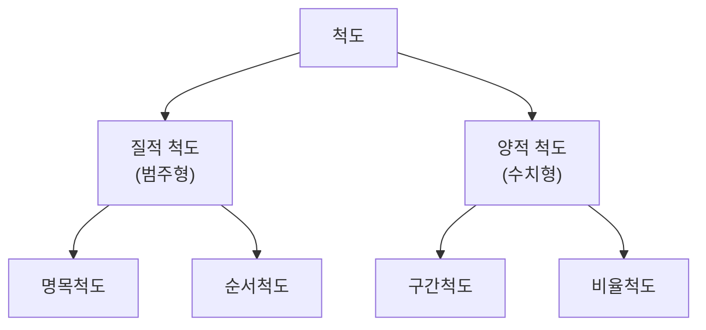

# 통계학 개론

---

# 통계와 표본조사

## 통계의 이해

| 구분 | 정의 |
|---|---|
| **통계 (Statistics)** | 특정 집단을 대상으로 수행한 조사나 실험의 결과로 얻은<br>**수치 자료의 요약된 형태** |
| **통계학** | 자료로부터 유용한 정보를 이끌어 내는 학문으로,<br>자료의 **수집 · 분류 · 요약 · 분석 · 추론**을 다루는 학문 |
| **통계 분석** | 특정 집단이나 불확실한 현상을 대상으로 자료를 수집해,<br>**그 집단의 특성을 규명하거나 미래를 예측**하는 분석 |

---

## 기본 용어 ⭐

| 용어 | 정의 |
|---|---|
| **모집단 (Population)** | 조사하고자 하는 **대상 집단 전체** |
| **표본 (Sample)** | 모집단에서 **뽑아낸 일부** |
| **모수 (Parameter)** | **모집단**의 특성값 (모평균 μ, 모분산 σ²) |
| **통계량 (Statistic)** | **표본**의 특성값 (표본평균 x̄, 표본분산 s²) |
| **전수조사** | 모집단 **전체를 조사**하는 방법 |
| **표본조사** | 표본만 조사해 모집단을 **추론**하는 방법 |


> **핵심 구조**: 모집단에서 표본을 **추출**하고, 표본의 통계량으로 모집단의 모수를 **추론**한다.

---

## 표본조사

| 항목 | 내용 |
|---|---|
| **정의** | 조사 대상인 **모집단 전체가 아니라 일부(표본)를 추출**하여 조사한 뒤,<br>그 결과로 **모집단 전체의 특성을 추론**하는 조사 방법 |
| **표본 대표성** | 모집한 표본은 **집단 전체를 대변할 수 있는 표본 대표성**이 있어야 함 |
| **중요성** | 표본 대표성의 **신뢰 여부가 통계 전체의 신뢰에 영향**을 줄 수 있음 |

### 표본조사를 하는 이유

| 이유 | 설명 |
|---|---|
| **비용·시간 절감** | 전수조사는 막대한 비용과 시간이 소요됨 |
| **전수조사 불가** | 제품 파괴검사처럼 전체를 조사할 수 없는 경우가 존재 |
| **신속성** | 빠르게 결과를 얻어 의사결정에 활용 가능 |

> **주의**: 표본이 모집단을 제대로 대변하지 못하면(**표본 편향**) 아무리 정교하게 분석해도 결과를 신뢰할 수 없다.

---
---

# 표본 추출 방법 ⭐

| 방법 | 한 줄 요약 |
|---|---|
| **단순 랜덤 추출법** | 그냥 **무작위로** 뽑음 |
| **계통 추출법** | **일정한 간격**으로 뽑음 |
| **집락 추출법** | **집단을 통째로** 뽑음 |
| **층화 추출법** | **층으로 나눈 뒤 각 층에서** 뽑음 |

---

## 1️⃣ 단순 랜덤 추출법 (Simple Random Sampling)

| 항목 | 내용 |
|---|---|
| **방법** | 가장 쉽고 단순한 방법으로, **N개의 모집단에서 n개의 데이터를 무작위로 추출** |
| **특징** | 모든 데이터가 **뽑힐 확률이 동일** |

```
모집단: ① ② ③ ④ ⑤ ⑥ ⑦ ⑧ ⑨ ⑩
추출:      ②    ④       ⑦       ⑩     ← 무작위
```

```r
sample(1:100, 10)                    # 비복원 추출
sample(1:100, 10, replace = TRUE)    # 복원 추출
```

| 구분 | 설명 |
|---|---|
| **복원 추출** | 뽑은 것을 **다시 넣고** 뽑음 → 중복 가능 |
| **비복원 추출** | 뽑은 것을 **빼고** 뽑음 → 중복 없음 (R의 기본값) |

---

## 2️⃣ 계통 추출법 (Systematic Sampling)

| 항목 | 내용 |
|---|---|
| **방법** | 모집단의 데이터에 **번호를 부여**한 뒤,<br>**일정한 간격(K)**을 두고 데이터를 추출하는 방법 |
| **절차** | ① 모집단을 K개 구간으로 나눔<br>② **첫 구간에서 하나를 무작위로** 선택<br>③ 그 이후로는 **K만큼 건너뛰며** 추출 |
| **간격 K** | **K = N ÷ n** (모집단 크기 ÷ 표본 크기) |

```
모집단 100명에서 10명 추출 → K = 10
첫 번째로 3번을 뽑았다면
추출: ③ ⑬ ㉓ ㉝ ㊸ ...   ← 10씩 건너뜀
```

| 장점 | 단점 |
|---|---|
| 절차가 **간편**하고 표본이 고르게 분포 | 데이터에 **주기성**이 있으면 편향 발생 |

> **주기성 문제 예시**: 7일 간격으로 매출을 뽑으면 항상 같은 요일만 뽑혀 왜곡된다.

---

## 3️⃣ 집락 추출법 (Cluster Sampling)

| 항목 | 내용 |
|---|---|
| **방법** | 모집단을 여러 개의 **집락(cluster)으로 나눈 뒤**,<br>**일부 집락을 통째로 선택**하여 그 안의 데이터를 조사하는 방법 |
| **집락의 성격** | 각 집락이 **모집단을 축소한 형태** — 집락 **내부는 이질적**, **집락 간에는 동질적** |

```
전국 → 시·도별로 나눔 (집락)
→ 그중 3개 시·도를 통째로 선택 → 그 안의 전원 조사
```

| 장점 | 단점 |
|---|---|
| **비용과 시간이 절약**됨 (조사 지역이 좁아짐) | 집락 간 차이가 크면 **표본 대표성이 떨어짐** |

> **활용**: 전국 조사처럼 **모집단이 지역적으로 넓게 퍼져 있을 때** 유용하다.

---

## 4️⃣ 층화 추출법 (Stratified Sampling)

| 항목 | 내용 |
|---|---|
| **방법** | 모집단을 **서로 겹치지 않는 여러 개의 층(strata)으로 나눈 뒤**,<br>**각 층에서 표본을 무작위로 추출**하는 방법 |
| **층의 성격** | **층 내부는 동질적**, **층 간에는 이질적** |

```
전교생 → 학년별로 나눔 (층)
→ 1학년에서 10명, 2학년에서 10명, 3학년에서 10명 추출
```

| 구분 | 설명 |
|---|---|
| **비례 층화 추출** | 각 층의 **크기에 비례**하여 표본 수를 배분 |
| **불비례 층화 추출** | 층의 크기와 무관하게 배분 |

| 장점 | 단점 |
|---|---|
| **표본 대표성이 높음**, 층별 비교 가능 | 층을 나누기 위한 **사전 정보가 필요** |

---

## 집락 추출법 vs 층화 추출법 ⭐

가장 헷갈리는 두 방법이다. **집단 내부와 집단 간의 성질**이 정반대다.

| 구분 | 집락 추출법 | 층화 추출법 |
|---|---|---|
| **집단 내부** | **이질적** (다양하게 섞임) | **동질적** (비슷한 것끼리) |
| **집단 간** | **동질적** (집락끼리 비슷) | **이질적** (층끼리 다름) |
| **추출 방식** | **일부 집단을 통째로** 선택 | **모든 집단에서 조금씩** 추출 |
| **목적** | 비용·시간 절약 | 표본 대표성 확보 |
| **예시** | 전국에서 3개 시·도만 선택해 전수조사 | 학년별로 나눠 각 학년에서 10명씩 |

> **구분 요령**: 집락은 **"몇 개 덩어리만 골라서 전부"**, 층화는 **"모든 층에서 조금씩"**

---

| **집락 추출** | 집락으로 나눈 뒤 **일부 집락을 통째로** 선택 |
| **층화 추출** | 층으로 나눈 뒤 **각 층에서** 추출 |
| **집락 vs 층화** | 집락: 내부 이질·집단 간 동질<br>층화: 내부 동질·집단 간 이질 |


---
---

# 측정과 척도

| 구분 | 개념 |
|---|---|
| **측정** | 조사 대상의 특성을 **일정한 규칙에 따라 수치나 기호로 부여**하는 것 |
| **척도** | 측정할 때 사용하는 **기준 또는 도구** |

## 척도의 종류



## 척도별 특성 비교 ⭐

| 구분 | 척도 | 범주 | 순서 | 상대적 크기<br>(간격) | 절대적 크기<br>(절대 0) |
|---|---|:---:|:---:|:---:|:---:|
| **질적 척도** | **명목척도** | ✅ | ❌ | ❌ | ❌ |
| **질적 척도** | **순서척도** | ✅ | ✅ | ❌ | ❌ |
| **양적 척도** | **구간척도** | ✅ | ✅ | ✅ | ❌ |
| **양적 척도** | **비율척도** | ✅ | ✅ | ✅ | ✅ |

> **누적 구조**: 아래로 갈수록 **성질이 하나씩 추가**된다. 비율척도가 가장 많은 정보를 담는다.

## 척도별 상세

| 척도 | 정의 | 예시 |
|---|---|---|
| **명목척도** | 대상을 **단순히 분류·구분**하기 위한 척도<br>숫자를 부여해도 크기의 의미가 없음 | 성별, 혈액형, 지역, 종교<br>전화번호, 등번호 |
| **순서척도**<br>(서열척도) | **순위·서열**을 매길 수 있는 척도<br>단, 간격이 일정하지 않음 | 학점(A/B/C), 만족도(상/중/하)<br>선호도, 신용등급, 석차 |
| **구간척도**<br>(등간척도) | 순서에 더해 **간격이 동일**한 척도<br>**절대 0점이 없어** 비율 계산 불가 | 온도(℃), IQ, 연도<br>시험 점수 |
| **비율척도** | 구간척도에 더해 **절대 0점이 존재**<br>덧셈·뺄셈·곱셈·나눗셈 모두 가능 | 키, 몸무게, 나이, 매출액<br>거리, 시간 |

## 구간척도 vs 비율척도 ⭐

가장 헷갈리는 두 척도. 구분 기준은 **"0이 진짜 없음을 뜻하는가"**다.

| 구분 | 구간척도 | 비율척도 |
|---|---|---|
| **절대 0** | 없음 (**임의로 정한 0**) | 있음 (**없음을 의미**) |
| **비율 계산** | 불가능 | 가능 |
| **예시** | 섭씨 0도 = 추운 온도 (온도 없음 ❌) | 0kg = 무게 없음 ⭕ |
| **판단** | 20℃는 10℃의 **2배가 아님** | 20kg은 10kg의 **2배가 맞음** |

---
---

# 기술 통계와 추리 통계

## 기술 통계 (Descriptive Statistics)

| 항목 | 내용 |
|---|---|
| **정의** | **표본 자체의 속성이나 특징을 파악**하는 데 중점을 두는 데이터 분석 통계 |
| **역할** | 자료를 **요약하고 조직화, 단순화**함 |
| **기술 통계량** | 표본조사 이후 표본을 설명해주는 데이터의<br>**최솟값, 최댓값, 중위수** 등의 통계량<br>→ **모집단의 특성을 유추하는 데 사용** |

```r
summary(iris)       # 대표적인 기술통계 출력
mean(x); median(x); sd(x)
```

---

## 추리 통계 (Inferential Statistics)

| 항목 | 내용 |
|---|---|
| **정의** | 수집한 데이터를 바탕으로 **추론 및 예측**하는 통계 기법 |
| **방법** | 표본에서 얻은 통계치를 바탕으로 **오차를 고려하면서**<br>**모수를 확률적으로 추정**하는 통계 기법 |
| **초점** | 표본에서 얻은 통계치로 **모집단의 특성을 추정**하는 데 초점을 두고<br>**가설을 검증**하거나 **확률적인 가능성을 파악** |
| **활용** | 이를 통해 **향후 발생할 수 있는 사건을 예측** 가능 |

---

## 두 통계 비교 ⭐

| 구분 | 기술 통계 | 추리 통계 |
|---|---|---|
| **대상** | **표본 자체** | **모집단** |
| **목적** | 요약 · 정리 · 설명 | 추정 · 검정 · 예측 |
| **오차 개념** | 없음 | **오차를 고려** |
| **결과** | 확정적 (사실 그대로) | 확률적 (~일 것이다) |
| **예시** | 평균, 중앙값, 표준편차, 그래프 | 신뢰구간, 가설검정, 회귀분석 |


> **관계**: 기술 통계로 **표본을 정리**한 뒤, 그 결과를 바탕으로 추리 통계가 **모집단을 추론**한다.

---

# 확률과 확률분포

## 1️⃣ 확률의 기본

| 용어 | 정의 |
|---|---|
| **시행** | 같은 조건에서 반복할 수 있는 실험 (예: 주사위 던지기) |
| **표본공간 (S)** | 시행에서 나올 수 있는 **모든 결과의 집합** |
| **사건 (Event)** | 표본공간의 **부분집합** |

### P(A) — 사건 A가 발생할 확률

```
              사건 A에 속하는 경우의 수
P(A) = ────────────────────────────────
              전체 경우의 수 (표본공간)
```

| 성질 | 내용 |
|---|---|
| **범위** | **0 ≤ P(A) ≤ 1** |
| **전체 확률** | P(S) = 1 |
| **여사건** | P(A<sup>c</sup>) = **1 − P(A)** |

```
주사위에서 짝수가 나올 확률
P(A) = 3/6 = 0.5      (2, 4, 6 중 하나)
```

---

## 2️⃣ 조건부 확률 P(B|A) ⭐

**사건 A가 이미 일어났다는 조건에서, 사건 B가 일어날 확률**

```
             P(A ∩ B)
P(B|A) = ─────────────       (단, P(A) > 0)
              P(A)
```

**곱셈 정리** — 위 식을 변형하면

```
P(A ∩ B) = P(A) × P(B|A)
```

### 예시

```
전체 학생 100명 중
  - 안경 쓴 학생(A): 40명
  - 안경 쓰고 남학생(A∩B): 24명

안경 쓴 학생 중 남학생일 확률
P(B|A) = 24/100 ÷ 40/100 = 0.6
```

> **핵심**: 조건부 확률은 **표본공간이 A로 좁아진 상태**에서의 확률이다. 분모가 전체가 아니라 P(A)가 되는 이유다.

---

## 3️⃣ 독립사건과 배반사건 ⭐

가장 헷갈리는 두 개념. **전혀 다른 이야기**다.

### 독립사건 (Independent Events)

**한 사건의 발생이 다른 사건의 발생 확률에 영향을 주지 않는** 경우

```
P(A ∩ B) = P(A) × P(B)
P(B|A) = P(B)          ← A가 일어나도 B의 확률은 그대로
```

**예시**: 동전을 던지고 주사위를 던지는 것. 동전 결과가 주사위에 영향을 주지 않는다.

### 배반사건 (Mutually Exclusive Events)

**두 사건이 동시에 일어날 수 없는** 경우 (교집합이 공집합)

```
A ∩ B = ∅
P(A ∩ B) = 0
P(A ∪ B) = P(A) + P(B)
```

**예시**: 주사위 한 번 던져서 "1이 나옴"과 "2가 나옴". 동시에 발생 불가능.

### 두 개념 비교

| 구분 | 독립사건 | 배반사건 |
|---|---|---|
| **의미** | 서로 **영향을 주지 않음** | 서로 **동시에 일어날 수 없음** |
| **교집합** | P(A∩B) = P(A)·P(B) | P(A∩B) = **0** |
| **관계** | 확률적 **무관함** | 물리적으로 **양립 불가** |
| **예시** | 동전 던지기 · 주사위 던지기 | 한 주사위에서 1 나오기 · 2 나오기 |

> **주의**: **배반사건은 독립이 아니다.** A가 일어나면 B는 절대 일어날 수 없으므로(P(B|A)=0), 오히려 **강하게 영향을 준다.**

---

## 4️⃣ 확률변수와 확률분포

### 확률변수 (Random Variable)

| 항목 | 내용 |
|---|---|
| **정의** | 표본공간의 각 결과에 **실수값을 대응시키는 함수** |
| **표기** | 대문자 **X, Y** 등으로 표시 |

```
동전 2개를 던질 때
X = 앞면이 나온 횟수   →   X는 0, 1, 2의 값을 가짐
```

### 확률변수의 종류 ⭐

| 구분 | 정의 | 예시 |
|---|---|---|
| **이산확률변수** | 셀 수 있는 값을 갖는 확률변수<br>(값이 **띄엄띄엄** 존재) | 주사위 눈, 불량품 개수,<br>고객 수 |
| **연속확률변수** | 특정 구간 내의 **모든 실수값**을 갖는 확률변수 | 키, 몸무게, 시간, 온도 |

### 확률함수

확률변수가 특정 값을 가질 확률을 나타내는 함수.

| 구분 | 함수명 | 표기 | 특징 |
|---|---|---|---|
| **이산** | **확률질량함수 (PMF)** | P(X = x) | 각 값의 **확률을 직접** 나타냄<br>**총합 = 1** |
| **연속** | **확률밀도함수 (PDF)** | f(x) | 한 점의 확률은 **0**<br>**넓이(적분)가 확률**, 전체 넓이 = 1 |

> **연속확률변수의 핵심**: P(X = 175cm) = 0 이다. 정확히 175.000...cm일 확률은 0이므로, **구간의 확률** P(174 ≤ X ≤ 176)로 계산한다.

### 확률분포 (Probability Distribution)

**확률변수가 가질 수 있는 값과 그 확률을 대응시킨 것**

```
동전 2개 던지기 — 앞면의 수 X

  X   |  0    1    2
------+----------------
P(X)  | 1/4  2/4  1/4     ← 합 = 1
```

### 주요 확률분포

| 구분 | 분포 | 설명 |
|---|---|---|
| **이산** | **이항분포** | n번 시행에서 성공 횟수 |
| **이산** | **포아송분포** | 단위 시간·공간당 발생 횟수 |
| **이산** | **기하분포** | 첫 성공까지의 시행 횟수 |
| **연속** | **정규분포** | 좌우 대칭 종 모양, 가장 기본 |
| **연속** | **t분포** | 표본이 작을 때 사용 |
| **연속** | **카이제곱분포** | 분산·독립성 검정 |
| **연속** | **F분포** | 두 분산의 비교 |

### 기댓값과 분산

| 개념 | 의미 |
|---|---|
| **기댓값 E(X)** | 확률변수의 **평균** — 장기적으로 기대되는 값 |
| **분산 V(X)** | 확률변수가 기댓값에서 **얼마나 흩어져 있는지** |

```
E(X) = Σ x · P(X = x)
V(X) = E(X²) − [E(X)]²
```

---
---
---

# 이산 확률분포

**이산확률변수**: 셀 수 있는 값을 갖는 확률변수 (주사위 눈, 불량품 개수 등) → **확률질량함수(PMF)**로 표현

| 분포 | 한 줄 요약 |
|---|---|
| **베르누이 분포** | **1회** 시행에서 성공/실패 |
| **이항 분포** | **n회** 시행에서 성공 횟수 |
| **기하 분포** | **첫 성공까지** 걸린 시행 횟수 |
| **다항 분포** | 결과가 **3가지 이상**인 시행의 횟수 |
| **포아송 분포** | 단위 시간·공간당 **발생 횟수** |

---

## 1️⃣ 베르누이 분포 (Bernoulli)

| 항목 | 내용 |
|---|---|
| **정의** | **단 한 번의 시행**에서 결과가 **성공(1) 또는 실패(0)** 두 가지뿐인 분포 |
| **모수** | p (성공 확률) |
| **확률함수** | P(X = x) = p<sup>x</sup>(1−p)<sup>1−x</sup> , x = 0 또는 1 |
| **기댓값** | **E(X) = p** |
| **분산** | **V(X) = p(1−p)** |

> **예시**: 동전 1번 던져 앞면이 나올 확률, 제품 1개가 불량일 확률

---

## 2️⃣ 이항 분포 (Binomial)

| 항목 | 내용 |
|---|---|
| **정의** | 성공 확률이 p인 **베르누이 시행을 n번 독립적으로 반복**했을 때<br>**성공 횟수**의 분포 |
| **표기** | X ~ B(n, p) |
| **확률함수** | P(X = x) = <sub>n</sub>C<sub>x</sub> · p<sup>x</sup>(1−p)<sup>n−x</sup> |
| **기댓값** | **E(X) = np** |
| **분산** | **V(X) = np(1−p)** |

> **베르누이와의 관계**: 이항분포에서 **n = 1이면 베르누이 분포**가 된다.

```
동전을 10번 던져 앞면이 3번 나올 확률
X ~ B(10, 0.5),  E(X) = 5
```

```r
dbinom(3, size = 10, prob = 0.5)   # 정확히 3번
pbinom(3, size = 10, prob = 0.5)   # 3번 이하
```

---

## 3️⃣ 기하 분포 (Geometric)

| 항목 | 내용 |
|---|---|
| **정의** | 성공 확률이 p인 시행에서 **첫 번째 성공이 나올 때까지의 시행 횟수** 분포 |
| **확률함수** | P(X = x) = (1−p)<sup>x−1</sup> · p |
| **기댓값** | **E(X) = 1/p** |
| **분산** | V(X) = (1−p)/p² |

> **예시**: 주사위를 던져 처음으로 6이 나올 때까지의 횟수. p = 1/6이므로 평균 6번 던져야 한다.

---

## 4️⃣ 다항 분포 (Multinomial)

| 항목 | 내용 |
|---|---|
| **정의** | 결과가 **3가지 이상의 범주**로 나뉘는 시행을 n번 반복했을 때,<br>각 범주가 발생한 횟수의 분포 |
| **관계** | **이항분포를 3개 이상의 범주로 확장**한 것 |

> **예시**: 주사위를 60번 던졌을 때 1~6이 각각 몇 번씩 나오는지의 분포

---

## 5️⃣ 포아송 분포 (Poisson)

| 항목 | 내용 |
|---|---|
| **정의** | **단위 시간 또는 단위 공간 내에서** 특정 사건이 발생하는 **횟수**의 분포 |
| **모수** | λ (람다) — 단위당 평균 발생 횟수 |
| **확률함수** | P(X = x) = (e<sup>−λ</sup> · λ<sup>x</sup>) / x! |
| **기댓값** | **E(X) = λ** |
| **분산** | **V(X) = λ** |

> **특징**: **평균과 분산이 모두 λ로 같다.** 이것이 포아송 분포의 결정적 특징이다.

```
예시: 1시간에 평균 3건의 문의가 오는 콜센터
     → 1시간에 5건이 올 확률은?
```

```r
dpois(5, lambda = 3)   # 정확히 5건
```

---

## 이산 분포 요약 ⭐

| 분포 | 기댓값 | 분산 |
|---|---|---|
| **베르누이** | p | p(1−p) |
| **이항** | **np** | **np(1−p)** |
| **기하** | 1/p | (1−p)/p² |
| **포아송** | **λ** | **λ** |

---
---

# 연속 확률분포

**연속확률변수**: 특정 구간 내의 **모든 실수값**을 갖는 확률변수 (키, 시간, 온도 등) → **확률밀도함수(PDF)**로 표현

> **핵심**: 한 점의 확률은 **0**이며, **구간의 넓이(적분)**가 확률이다.

| 분포 | 한 줄 요약 |
|---|---|
| **균일 분포** | 모든 구간의 확률이 **동일** |
| **정규 분포** | 좌우 대칭 **종 모양** — 가장 기본 |
| **t-분포** | 표본이 **작을 때** 정규분포 대신 사용 |
| **카이제곱 분포** | **분산·독립성** 검정 |
| **F-분포** | **두 분산의 비**를 다룸 |

---

## 1️⃣ 균일 분포 (Uniform)

| 항목 | 내용 |
|---|---|
| **정의** | 구간 [a, b]에서 **모든 값이 동일한 확률밀도**를 갖는 분포 |
| **확률밀도함수** | f(x) = 1 / (b − a) |
| **기댓값** | **E(X) = (a+b)/2** |
| **분산** | V(X) = (b−a)²/12 |

> **모양**: 직사각형. 예) 0~1 사이의 난수 생성 `runif()`

---

## 2️⃣ 정규 분포 (Normal) ⭐

| 항목 | 내용 |
|---|---|
| **정의** | 평균 μ를 중심으로 **좌우 대칭인 종 모양(bell shape)** 분포 |
| **표기** | X ~ N(μ, σ²) |
| **모수** | μ (평균), σ² (분산) |
| **기댓값** | **E(X) = μ** |
| **분산** | **V(X) = σ²** |

### 정규분포의 특징

| 특징 | 설명 |
|---|---|
| **좌우 대칭** | 평균을 중심으로 대칭 |
| **평균 = 중앙값 = 최빈값** | 세 값이 모두 일치 |
| **전체 면적 = 1** | 확률의 총합 |
| **μ가 위치, σ가 퍼짐** | μ는 좌우 이동, σ가 클수록 납작해짐 |

### 표준정규분포 (Z분포)

**평균 0, 분산 1**로 표준화한 정규분포

```
        X − μ
Z = ───────────
          σ
```

### 68-95-99.7 법칙 ⭐

| 범위 | 포함 비율 |
|---|---|
| **μ ± 1σ** | 약 **68%** |
| **μ ± 2σ** | 약 **95%** |
| **μ ± 3σ** | 약 **99.7%** |

> 앞서 배운 **ESD 이상값 판단(평균 ± 3σ)**의 근거가 바로 이것이다.

---

## 3️⃣ t-분포

| 항목 | 내용 |
|---|---|
| **정의** | 정규분포와 유사한 **좌우 대칭 종 모양**이지만,<br>**꼬리가 더 두꺼운** 분포 |
| **사용 시점** | **표본 크기가 작고(n < 30)**, **모분산(σ²)을 모를 때** |
| **모수** | 자유도 (df = n − 1) |
| **성질** | 자유도가 커질수록 **정규분포에 가까워짐** |
| **활용** | **두 집단의 평균 차이 검정** (t-검정) |

---

## 4️⃣ 카이제곱 분포 (χ²)

| 항목 | 내용 |
|---|---|
| **정의** | 표준정규분포를 따르는 확률변수의 **제곱합**이 따르는 분포 |
| **모양** | **왼쪽으로 치우친 비대칭** (양수만 가짐) |
| **모수** | 자유도 |
| **활용** | **분산의 검정**, **적합도 검정**, **독립성 검정** (범주형 자료) |

---

## 5️⃣ F-분포

| 항목 | 내용 |
|---|---|
| **정의** | **두 카이제곱 분포의 비**가 따르는 분포 |
| **모양** | 비대칭 (양수만 가짐) |
| **모수** | 두 개의 자유도 |
| **활용** | **두 집단의 분산 비교**, **분산분석(ANOVA)**, **회귀모형의 유의성 검정** |

---

## 연속 분포 정리 ⭐

| 분포 | 주요 용도 |
|---|---|
| **정규분포** | 기본이 되는 분포 |
| **t-분포** | **평균** 검정 (표본이 작을 때) |
| **카이제곱분포** | **분산** 검정, **독립성·적합도** 검정 |
| **F-분포** | **두 분산의 비교**, 분산분석 |

---
---

# 기술 통계량

## 1️⃣ 중심 경향 — 기댓값

| 개념 | 정의 | 공식 |
|---|---|---|
| **기댓값 E(X)** | 확률변수의 **평균** — 장기적으로 기대되는 값 | E(X) = Σ x · P(X = x) |
| **평균** | 모든 값의 합 ÷ 개수 | x̄ = Σxᵢ / n |
| **중앙값** | 크기순 정렬 시 **가운데 값** | |
| **최빈값** | 가장 **자주 나오는 값** | |

> **평균 vs 중앙값**: 평균은 **이상값에 민감**하고, 중앙값은 **강건(robust)**하다. 소득처럼 한쪽으로 치우친 데이터는 중앙값이 더 대표성이 있다.

---

## 2️⃣ 산포도 — 분산과 표준편차

| 개념 | 정의 | 공식 |
|---|---|---|
| **분산 V(X)** | 값들이 평균에서 **얼마나 흩어져 있는지** | V(X) = E(X²) − [E(X)]² |
| **모분산 σ²** | 모집단의 분산 | σ² = Σ(xᵢ − μ)² / **N** |
| **표본분산 s²** | 표본의 분산 | s² = Σ(xᵢ − x̄)² / **(n−1)** |
| **표준편차** | 분산의 **제곱근** | s = √s² |

> **왜 n−1인가**: 표본분산은 모분산을 과소추정하는 경향이 있어, **자유도(n−1)**로 나눠 보정한다. 이를 **불편추정량**이라 한다.

| 그 외 산포도 | 설명 |
|---|---|
| **범위 (Range)** | 최댓값 − 최솟값 |
| **사분위 범위 (IQR)** | Q3 − Q1 |
| **변동계수 (CV)** | 표준편차 ÷ 평균 — **단위가 다른 자료 비교**에 사용 |

---

## 3️⃣ 첨도와 왜도 ⭐

분포의 **모양**을 나타내는 지표다.

### 왜도 (Skewness) — 비대칭도

| 값 | 모양 | 관계 |
|---|---|---|
| **왜도 = 0** | 좌우 **대칭** (정규분포) | 평균 = 중앙값 = 최빈값 |
| **왜도 > 0** | **오른쪽 꼬리가 김** (양의 왜도) | **최빈값 < 중앙값 < 평균** |
| **왜도 < 0** | **왼쪽 꼬리가 김** (음의 왜도) | **평균 < 중앙값 < 최빈값** |

```
양의 왜도 (오른쪽 꼬리)        음의 왜도 (왼쪽 꼬리)
    ▲                              ▲
   ███                           ███
  █████▄▄▄▄                 ▄▄▄▄█████
  최중평                       평중최
```

> **기억법**: 꼬리가 **긴 쪽으로 평균이 끌려간다.** 오른쪽 꼬리가 길면 평균이 가장 오른쪽.

### 첨도 (Kurtosis) — 뾰족한 정도

| 값 | 모양 |
|---|---|
| **첨도 = 3** | 정규분포와 같음 (기준) |
| **첨도 > 3** | 정규분포보다 **뾰족함** (꼬리가 두꺼움) |
| **첨도 < 3** | 정규분포보다 **완만함** (납작함) |

> **주의**: 기준을 **0**으로 놓는 경우도 있다(초과첨도 = 첨도 − 3). 문제에서 어느 기준인지 확인해야 한다.

---

## 4️⃣ 공분산과 상관계수 ⭐

두 변수 사이의 **관계**를 나타내는 지표다.

### 공분산 (Covariance)

| 항목 | 내용 |
|---|---|
| **정의** | 두 변수가 **함께 변하는 정도** |
| **공식** | Cov(X, Y) = E(XY) − E(X)E(Y) |
| **범위** | **−∞ ~ +∞** (제한 없음) |
| **해석** | 양수 → 같은 방향 / 음수 → 반대 방향 / 0 → 선형관계 없음 |
| **한계** | **단위에 영향**을 받아 관계의 **강도를 비교할 수 없음** |

### 상관계수 (Correlation Coefficient)

| 항목 | 내용 |
|---|---|
| **정의** | 공분산을 **표준화**하여 −1 ~ 1 사이 값으로 만든 것 |
| **공식** | r = Cov(X, Y) / (σ<sub>X</sub> · σ<sub>Y</sub>) |
| **범위** | **−1 ≤ r ≤ 1** |
| **장점** | 단위와 무관 → **관계의 강도를 비교 가능** |

| r 값 | 의미 |
|---|---|
| **r = 1** | 완전한 **양의 선형관계** |
| **r > 0** | 양의 상관 (한쪽이 커지면 다른 쪽도 커짐) |
| **r = 0** | **선형관계 없음** |
| **r < 0** | 음의 상관 |
| **r = −1** | 완전한 **음의 선형관계** |

### 상관계수의 종류

| 종류 | 사용 대상 |
|---|---|
| **피어슨 상관계수** | **등간·비율척도** (연속형) — 선형관계 측정 |
| **스피어만 상관계수** | **순서척도** — 순위 기반, 비선형 관계도 측정 |

```r
cov(x, y)     # 공분산
cor(x, y)     # 피어슨 상관계수 (기본)
cor(x, y, method = "spearman")
```

> **주의 1**: 상관계수는 **선형관계만** 측정한다. r = 0이어도 곡선 관계는 있을 수 있다.
> **주의 2**: **상관관계 ≠ 인과관계**. 함께 움직인다고 원인·결과인 것은 아니다.

---
---

# 추정과 가설검정

## 모수의 추정

**표본의 통계량으로 모집단의 모수를 추측하는 것**

| 구분 | 정의 | 특징 |
|---|---|---|
| **점추정 (Point Estimation)** | 모수를 **하나의 값**으로 추정 | 간단하지만 **정확도·오차를 알 수 없음** |
| **구간추정 (Interval Estimation)** | 모수가 포함될 것으로 기대되는 **구간을 제시** | 신뢰도를 함께 제시 |

### 점추정

```
표본평균 x̄ = 175cm  →  "모평균은 175cm일 것이다"
```

| 조건 | 설명 |
|---|---|
| **불편성** | 추정량의 기댓값이 모수와 같음 |
| **효율성** | 추정량의 분산이 작음 |
| **일치성** | 표본이 커질수록 모수에 가까워짐 |
| **충족성** | 모수에 대한 정보를 충분히 담음 |

### 구간추정 — 신뢰구간

```
신뢰구간 = 점추정값 ± (신뢰계수 × 표준오차)
```

| 용어 | 의미 |
|---|---|
| **신뢰수준** | 구간이 모수를 포함할 확률 (보통 **95%**, 99%) |
| **신뢰구간** | 모수가 포함될 것으로 추정되는 구간 |

> **95% 신뢰구간의 올바른 해석**: "같은 방법으로 100번 조사하면 **약 95번은 그 구간 안에 모수가 들어온다**"는 뜻이다. "모수가 이 구간에 있을 확률이 95%"라는 표현은 엄밀히는 틀리다.

| 관계 | 영향 |
|---|---|
| 신뢰수준 ↑ | 신뢰구간 **넓어짐** |
| 표본 크기 ↑ | 신뢰구간 **좁아짐** (정밀해짐) |

---

## 가설 검정

**모집단에 대한 가설을 세우고, 표본 자료로 그 가설의 채택 여부를 결정하는 과정**

### 귀무가설과 대립가설 ⭐

| 구분 | 기호 | 정의 |
|---|---|---|
| **귀무가설** (Null Hypothesis) | **H₀** | **기존에 알려진 사실**, "차이가 없다·효과가 없다"<br>→ **기각하고자 하는** 가설 |
| **대립가설** (Alternative Hypothesis) | **H₁** | 연구자가 **주장하고자 하는** 가설<br>"차이가 있다·효과가 있다" |

```
예시) 신약의 효과를 검증
H₀: 신약은 효과가 없다 (기존 약과 차이 없음)
H₁: 신약은 효과가 있다
```

> **핵심 원리**: 가설검정은 **귀무가설이 참이라고 가정**한 뒤, 관측된 결과가 그 가정 하에서 **얼마나 일어나기 어려운지**를 따진다. 매우 드물다면 귀무가설을 **기각**한다.

---

### 제1종 오류와 제2종 오류 ⭐⭐

| | **H₀가 참** | **H₀가 거짓** |
|---|---|---|
| **H₀ 기각** | **제1종 오류 (α)** ❌ | 옳은 결정 ⭕ |
| **H₀ 채택** | 옳은 결정 ⭕ | **제2종 오류 (β)** ❌ |

| 오류 | 정의 | 비유 |
|---|---|---|
| **제1종 오류 (α)** | **참인 귀무가설을 기각**하는 오류 | 무죄인 사람을 **유죄로 판결** |
| **제2종 오류 (β)** | **거짓인 귀무가설을 채택**하는 오류 | 유죄인 사람을 **무죄로 방면** |

> **트레이드오프**: α를 줄이면 β가 커진다. 일반적으로 **제1종 오류가 더 치명적**이라고 보아 α를 먼저 통제한다.

> **검정력 (Power) = 1 − β**: 거짓인 귀무가설을 올바르게 기각할 확률

---

### 검정 통계량 · 기각역 · 유의수준 · 유의확률

| 용어 | 정의 |
|---|---|
| **검정 통계량** | 가설 검정을 위해 **표본으로부터 계산한 값**<br>(Z값, t값, χ²값, F값 등) |
| **기각역 (Critical Region)** | 귀무가설을 **기각하게 되는 검정통계량의 영역** |
| **유의수준 (α)** | **제1종 오류를 범할 최대 허용 확률**<br>일반적으로 **0.05 (5%)**, 0.01 사용 |
| **유의확률 (p-value)** | 귀무가설이 참일 때, **관측된 결과 이상이 나타날 확률** |

### 판정 규칙 ⭐

```
p-value < 유의수준(α)   →   귀무가설 기각   (대립가설 채택)
p-value ≥ 유의수준(α)   →   귀무가설 채택
```

> **암기**: **"p가 작으면 기각"** — p값이 작다는 건 "귀무가설이 참이라면 이런 결과가 나올 리 없다"는 뜻이므로 귀무가설을 버린다.

```
p = 0.03,  α = 0.05  →  0.03 < 0.05  →  H₀ 기각 (유의함)
p = 0.20,  α = 0.05  →  0.20 > 0.05  →  H₀ 채택 (유의하지 않음)
```

**R 출력 읽기**

```
Coefficients:
            Estimate  Pr(>|t|)    
(Intercept)   2.3251   0.0021 ** 
x             0.8134   0.0004 ***
```

> `Pr(>|t|)`가 **p-value**다. 별표(`***`, `**`, `*`)가 많을수록 유의하다.

---

## 모수 검정과 비모수 검정 ⭐

| 구분 | 모수 검정 | 비모수 검정 |
|---|---|---|
| **분포 가정** | 모집단이 **특정 분포(정규분포)를 따른다고 가정** | 분포에 대한 **가정 없음** |
| **사용 자료** | **등간·비율척도** (연속형) | **명목·순서척도**도 가능 |
| **표본 크기** | 크기가 충분해야 함 (n ≥ 30) | **표본이 작아도** 사용 가능 |
| **검정 대상** | 평균, 분산 등 **모수** | 순위, 부호 등 |
| **검정력** | 가정이 맞으면 **더 강력** | 상대적으로 약함 |
| **대표 기법** | t-검정, 분산분석(ANOVA), Z-검정 | 부호검정, 윌콕슨 순위합 검정,<br>크루스칼-왈리스 검정, 만-휘트니 U 검정 |

> **선택 기준**: 정규성 가정을 만족하면 **모수 검정**(더 정확), 만족하지 않거나 표본이 작으면 **비모수 검정**을 쓴다.

---
---

# 시험 대비 핵심 포인트

## 확률분포

| 주제 | 핵심 내용 |
|---|---|
| **베르누이** | **1회** 시행, E(X) = p |
| **이항분포** | **n회** 시행의 성공 횟수, **E(X) = np, V(X) = np(1−p)** |
| **기하분포** | 첫 성공까지의 횟수, E(X) = 1/p |
| **포아송분포** | 단위당 발생 횟수, **평균 = 분산 = λ** |
| **정규분포** | 좌우 대칭 종 모양, **평균 = 중앙값 = 최빈값** |
| **68-95-99.7** | μ±1σ / μ±2σ / μ±3σ |
| **t-분포** | 표본이 **작고 모분산을 모를 때**, 평균 검정 |
| **카이제곱분포** | **분산·독립성·적합도** 검정 |
| **F-분포** | **두 분산 비교**, 분산분석 |

## 기술 통계량

| 주제 | 핵심 내용 |
|---|---|
| **표본분산** | **n−1**로 나눔 (자유도 보정) |
| **왜도 > 0** | 오른쪽 꼬리 김, **최빈값 < 중앙값 < 평균** |
| **왜도 < 0** | 왼쪽 꼬리 김, **평균 < 중앙값 < 최빈값** |
| **첨도 > 3** | 정규분포보다 뾰족함 |
| **공분산** | 범위 **−∞ ~ ∞**, 단위 영향 받음 |
| **상관계수** | 범위 **−1 ~ 1**, 단위 무관 |
| **피어슨 vs 스피어만** | 연속형(등간·비율) / **순서척도** |
| **상관 ≠ 인과** | 함께 움직여도 원인·결과는 아님 |

## 추정과 검정

| 주제 | 핵심 내용 |
|---|---|
| **점추정 vs 구간추정** | 하나의 값 / **구간 + 신뢰수준** |
| **귀무가설 H₀** | 기존 사실, "차이 없다" — **기각 대상** |
| **대립가설 H₁** | 연구자의 **주장** |
| **제1종 오류 (α)** | **참인 H₀를 기각** (무죄를 유죄로) |
| **제2종 오류 (β)** | **거짓인 H₀를 채택** (유죄를 무죄로) |
| **검정력** | **1 − β** |
| **유의수준 α** | 제1종 오류의 **최대 허용 확률** (보통 0.05) |
| **판정 규칙** | **p < α → 귀무가설 기각** |
| **모수 검정** | 정규분포 **가정 O**, 등간·비율척도 |
| **비모수 검정** | 분포 **가정 X**, 표본이 작아도 가능 |
